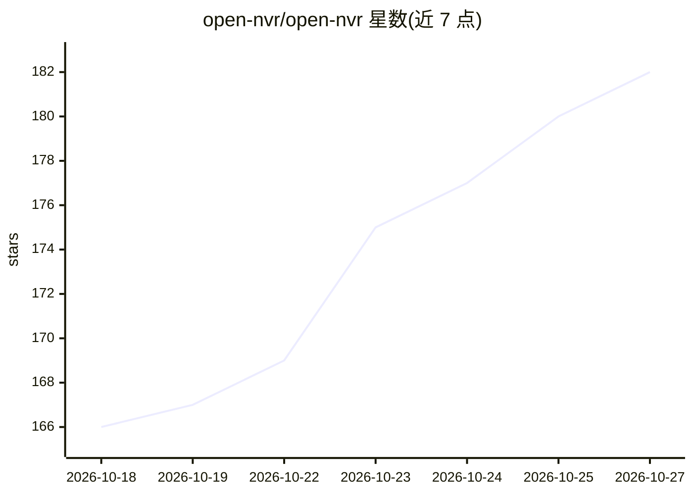

# open-nvr/open-nvr

⭐ 182 · Python · AGPL-3.0 · 推送 2026-10-26 · [GitHub](https://github.com/open-nvr/open-nvr) · [官网](https://opennvr.org) · 组织维护

**自托管开源 NVR：在自有硬件上运行任意 AI 模型的摄像头视频平台**

面向不能把摄像头交给厂商的组织与个人：单套 Docker 安装内含完整 NVR（ONVIF/RTSP 接入、录制、直播、WebRTC）与 AI 平台，通过一个开放契约把任意模型接入为能力（检测、车牌、人脸、姿态、场景描述、语音等），附带 12 个一键安装应用与两个 Apache-2.0 SDK（PyPI）供写应用或适配器。默认本地运行，支持完全离线/物理隔离，模型权重 SHA-256 指纹与审计日志可追溯每个决策；通过 MQTT 发现集成 Home Assistant。限制：需 Docker，首次启动下载镜像需 8–15 分钟。

## 筛选速览

| 维度 | 判定 | 备注 |
|---|---|---|
| AI 角色 | `ai-native` | 本体是模型或模型工具 |
| 许可风险 | `dual` | AGPL-3.0 |
| 部署形态 | `self-host` | docker 或自建部署 |
| 模型依赖 | — | README 未给出锁定关系 |
| 硬件要求 | — | 无带数字的原话,不猜 |
| 安装摩擦 | `low` | 无编译、无系统依赖或容器化 |
| 成熟度 | — | 结构信号不足 |

## 能力要点

- 一个开放契约接入任意 AI 模型（检测/车牌/人脸/VLM/语音），容器化热插拔
- 12 个预置应用（入侵、徘徊、车牌、门铃等）+ App/Adapter 双 SDK（PyPI）
- 默认本地/离线运行：default-deny 云路由门禁、权重指纹与 append-only 审计日志
- Home Assistant 通过 MQTT discovery 集成，无需在 HA 侧安装组件

## 适用场景

- 在自有硬件上自建带 AI 检测/车牌识别的录像监控系统
- 物理隔离或内网环境部署可审计的摄像头 AI 平台
- 基于事件总线编写自定义检测规则应用或模型适配器

## 场景标签

`网络安全` `目标检测` · 领域:学习与行业

## 证据(README 行号)

> L72: 2. **An AI platform for cameras.** Any model behind a REST or WebSocket endpoint becomes a capability through a pub
> L20: - **Any AI model.** One open contract: swap the detector, add plate reading or a vision-language model, and nothing
> L21: - **Local by default.** Recording, AI and the assistant run on your hardware. Cloud models are opt-in and audited.

## 星数曲线

2026-10-18 166 → 2026-10-27 182（+16）

---
*卡片 v1 · prompt 1.4 · 生成 2026-10-22 · 置信度 high · 依据 README sha `43d1b07c7ee0` · [字段定义](../../DATASET.md)*
