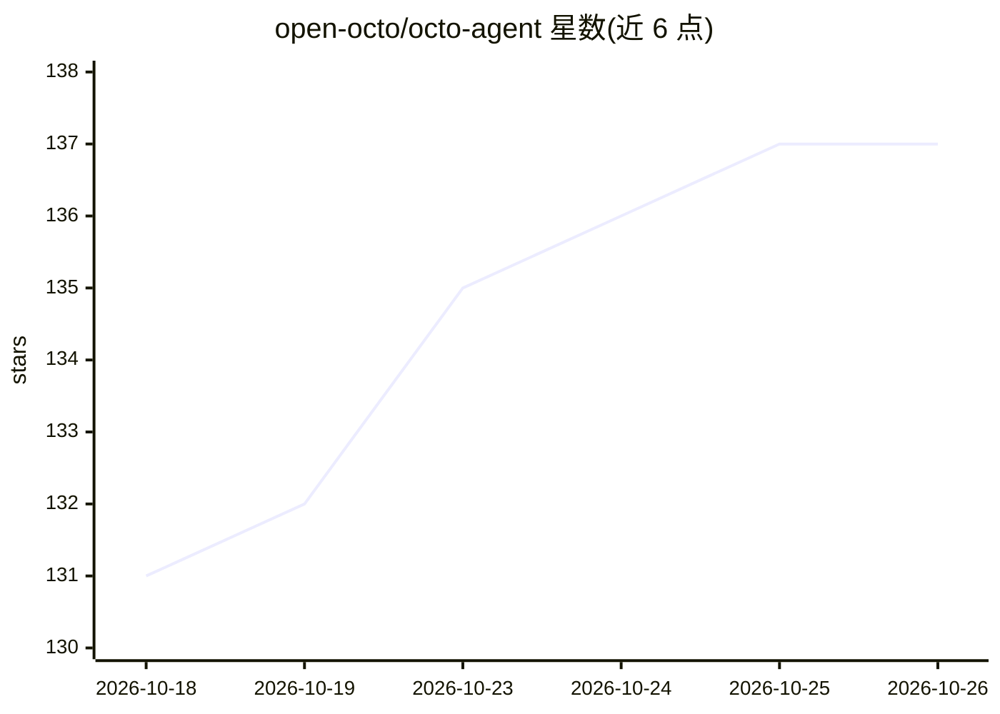

# open-octo/octo-agent

⭐ 137 · Go · MIT · 推送 2026-10-22 · [GitHub](https://github.com/open-octo/octo-agent) · [官网](https://octo-agent.dev/) · 组织维护 · 中文 README

**单二进制自托管 AI agent，覆盖八种交互入口**

以 MIT 许可的 Go 单二进制（约 40 MB）分发的自托管 AI agent，定位为编码代理与个人助手。同一二进制提供 TUI、CLI、Web UI、桌面应用、IM 桥接、VS Code/Obsidian 扩展与移动端（开发预览）八种入口。原生支持 DeepSeek、Kimi、Qwen、Anthropic、OpenAI 及任意 OpenAI/Anthropic 协议兼容端点，内置 shell/文件/搜索工具、MCP、技能（兼容 Claude Code 的 SKILL.md）与子代理；自托管、无遥测。安全机制包括硬编码拒绝灾难性命令、删除先入回收站、可选 Seatbelt/Landlock 沙箱。

## 筛选速览

| 维度 | 判定 | 备注 |
|---|---|---|
| AI 角色 | `ai-native` | 本体是模型或模型工具 |
| 许可风险 | `permissive` | MIT |
| 部署形态 | `desktop` | 安装包/桌面程序 |
| 模型依赖 | locked-api |  |
| 硬件要求 | — | 无带数字的原话,不猜 |
| 安装摩擦 | `low` | 无编译、无系统依赖或容器化 |
| 成熟度 | — | 结构信号不足 |

## 能力要点

- 单 ~40 MB Go 二进制，无 Node/Python/Ruby 依赖
- 八种交互入口共用同一二进制与配置
- 原生支持 OpenAI/Anthropic 协议兼容端点，按提供商调优提示缓存
- 硬编码拒绝灾难性命令，删除/覆盖先备份至回收站（默认 14 天/10 GiB）

## 适用场景

- 在本地服务器运行一个可从终端、浏览器、IM、编辑器访问的 AI agent
- 用一条 prompt 驱动完整 agent 循环完成编码任务
- 把 AI 助手接入微信/飞书/Telegram 持续对话
- 自托管并保留模型选择与数据所有权

## 场景标签

`编码 Agent` `AI 助手` · 领域:编码与开发

## 证据(README 行号)

> L5: **An open-source, single-binary, self-hosted AI agent.**
> L32: - **Works out of the box**: shell, file read/write/edit, search, MCP servers, skills, and sub-agents are all on by 
> L44: - **Eight interfaces**: TUI, CLI, Web UI, desktop app, IM bridge, VS Code, Obsidian, and mobile — few other agent p

## 星数曲线

2026-10-18 131 → 2026-10-26 137（+6）

---
*卡片 v1 · prompt 1.4 · 生成 2026-10-22 · 置信度 high · 依据 README sha `3cfae4678652` · [字段定义](../../DATASET.md)*
