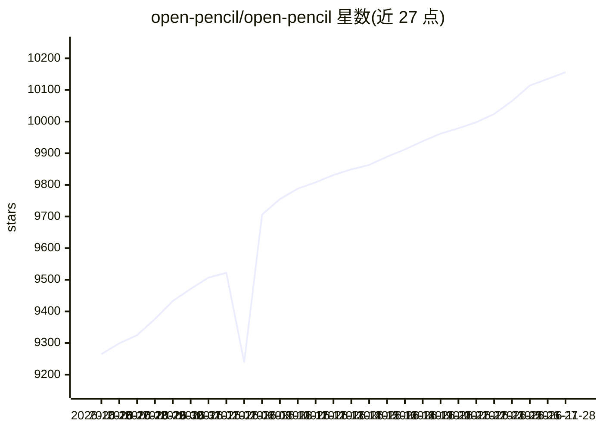

# open-pencil/open-pencil

⭐ 10,156 · TypeScript · MIT · 推送 2026-11-27 · [GitHub](https://github.com/open-pencil/open-pencil) · [官网](https://openpencil.dev) · 组织维护

**开源设计编辑器：读写 Figma 文件并内置 AI 助手**

开源（MIT）设计编辑器，可读写 .fig 与 .pen 文件，内置带 100+ 工具的 AI 聊天助手，用户自带各提供商 API key 即可用自然语言生成与修改画布节点。提供 headless CLI（XPath 查询、导出、lint、design token 提取）、Figma Plugin API 兼容 eval、MCP server 供编码 agent 操控画布，以及 headless Vue SDK 用于嵌入自定义编辑器。桌面端基于 Tauri v2，约 15 MB；协作走 WebRTC P2P，无需服务器或账号。README 自述仍在活跃开发中，存在粗糙之处。

## 筛选速览

| 维度 | 判定 | 备注 |
|---|---|---|
| AI 角色 | `ai-enhanced` | 去掉 AI 部分产品仍成立 |
| 许可风险 | `permissive` | MIT |
| 部署形态 | `desktop` | 安装包/桌面程序 |
| 模型依赖 | locked-api |  |
| 硬件要求 | — | 无带数字的原话,不猜 |
| 安装摩擦 | `low` | 无编译、无系统依赖或容器化 |
| 成熟度 | `idea` | |

## 能力要点

- AI 聊天助手带 100+ 工具，支持 BYOK 多提供商与兼容端点
- headless CLI 支持 XPath 查询、格式转换、lint 与 design token 提取
- MCP server 使 Claude Code/Cursor 等 agent 可检视与修改设计文档
- WebRTC P2P 实时协作，无需服务器与账号

## 适用场景

- 打开并编辑 Figma 设计文件而不依赖其官方软件
- 通过 AI 对话生成和批量修改设计画布
- 用脚本/CLI 自动化检查、导出设计资产
- 团队实时协作编辑设计文档

## 场景标签

 · 领域:设计/创意工具

## 证据(README 行号)

> L9: Open-source design editor. Opens `.fig` and `.pen` design files, includes built-in AI, and ships as a programmable t
> L34: - **AI builds designs** — describe what you want in chat, 100+ tools create and modify nodes. Bring your own key fo
> L42: - **Real-time collaboration** — share a peer-to-peer room over WebRTC with no server or account, or edit Cloud docu

## 星数曲线

2026-10-26 9,265 → 2026-11-28 10,156（+891）

---
*卡片 v1 · prompt 1.4 · 生成 2026-11-28 · 置信度 high · 依据 README sha `698a8552ba2b` · [字段定义](../../DATASET.md)*
