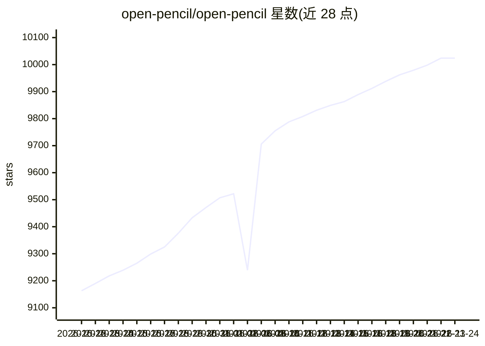

# open-pencil/open-pencil

⭐ 10,065 · TypeScript · MIT · 推送 2026-11-24 · [GitHub](https://github.com/open-pencil/open-pencil) · [官网](https://openpencil.dev) · 组织维护

**开源设计编辑器：读写 .fig 文件并内置 AI 生成设计**

基于 Tauri/Skia 的开源设计编辑器，可读写 Figma 原生 .fig 文件，支持组件、自动布局、实时 P2P 协作与设计转代码导出。内置 AI 助手带 100+ 工具，通过自带 API key 调用多家模型在画布上创建和修改节点；提供 headless CLI（XPath 查询、lint、格式转换）、MCP server、Figma Plugin API 兼容的 eval，以及嵌入自定义编辑器的 Vue SDK。处于活跃开发状态，存在未打磨之处。

## 筛选速览

| 维度 | 判定 | 备注 |
|---|---|---|
| AI 角色 | `ai-enhanced` | 去掉 AI 部分产品仍成立 |
| 许可风险 | `permissive` | MIT |
| 部署形态 | `desktop` | 安装包/桌面程序 |
| 模型依赖 | — | README 未给出锁定关系 |
| 硬件要求 | — | 无带数字的原话,不猜 |
| 安装摩擦 | `low` | 无编译、无系统依赖或容器化 |
| 成熟度 | — | 结构信号不足 |

## 能力要点

- 读写 Figma 原生 .fig 文件，本地优先，MIT 开源
- 内置 AI 助手 100+ 工具创建/修改画布节点，BYOK 多供应商
- headless CLI + MCP server + Figma Plugin API 兼容 eval，全流程可脚本化
- WebRTC P2P 实时协作，无需服务器与账号

## 适用场景

- 无 Figma 账号时打开和编辑 .fig 设计文件
- 让 AI 编码代理通过 MCP 检查和修改设计稿
- 批量导出、lint 设计文件并提取 design tokens
- 为自己的应用嵌入可编程的设计编辑界面

## 场景标签

 · 领域:设计/创意工具

## 证据(README 行号)

> L34: - **AI builds designs** — describe what you want in chat, 100+ tools create and modify nodes. Bring your own key fo
> L9: Open-source design editor. Opens `.fig` and `.pen` design files, includes built-in AI, and ships as a programmable t
> L41: - **Vue SDK for custom editors** — headless components and composables for embedding OpenPencil into other apps or 

## 星数曲线

2026-10-22 9,163 → 2026-11-24 10,024（+861）

---
*卡片 v1 · prompt 1.4 · 生成 2026-11-24 · 置信度 high · 依据 README sha `8244d3ba7be6` · [字段定义](../../DATASET.md)*
