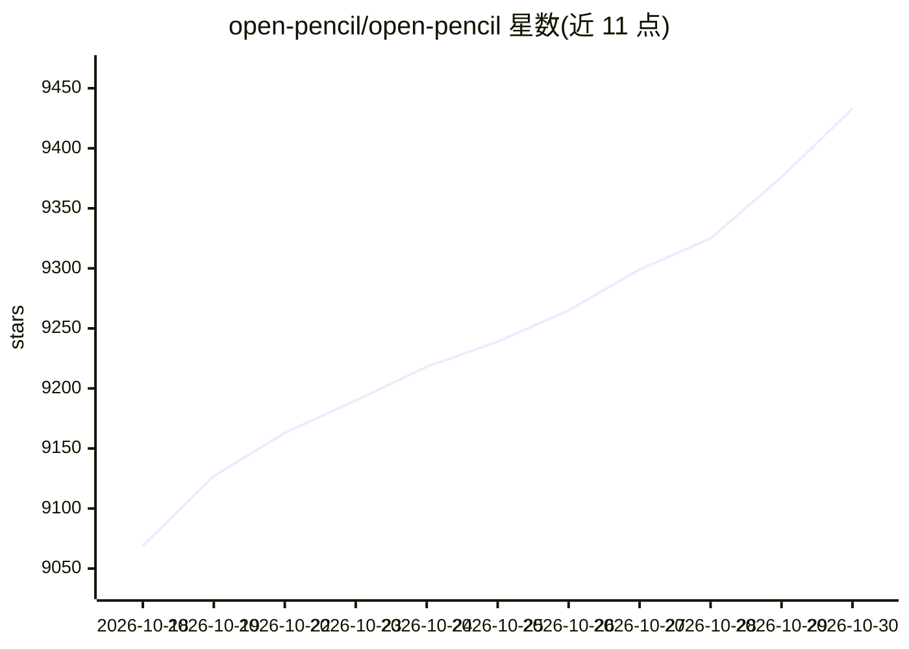

# open-pencil/open-pencil

⭐ 9,433 · TypeScript · MIT · 推送 2026-10-29 · [GitHub](https://github.com/open-pencil/open-pencil) · [官网](https://openpencil.dev) · 组织维护

**开源设计编辑器：读写 .fig 文件并内置 AI 生成设计**

MIT 许可的开源设计编辑器，定位为 Figma 替代品：原生读取/写入 .fig 与 .pen 文件，支持组件、自动布局、CSS Grid、实时 P2P 协作（WebRTC，无服务器无账号）。内置 AI 助手（100+ 工具，BYOK 接入 OpenRouter/Anthropic/OpenAI/DeepSeek 等）通过对话创建和修改节点，另提供 headless CLI（树浏览/XPath 查询/导出/检查/eval 脚本）、MCP server 供 Claude Code、Cursor 等编码 agent 调用，以及嵌入自定义编辑器的 Vue SDK。桌面端为 Tauri v2（约 15 MB），也可作为浏览器 PWA 运行；官方构建每日发送一次匿名 ping。自称尚在积极开发中，存在 Figma 兼容性差距与粗糙边缘。

## 筛选速览

| 维度 | 判定 | 备注 |
|---|---|---|
| AI 角色 | `ai-enhanced` | 去掉 AI 部分产品仍成立 |
| 许可风险 | `permissive` | MIT |
| 部署形态 | `desktop` | 安装包/桌面程序 |
| 模型依赖 | locked-api |  |
| 硬件要求 | — | 无带数字的原话,不猜 |
| 安装摩擦 | `low` | 无编译、无系统依赖或容器化 |
| 成熟度 | `idea` | |

## 能力要点

- 原生读写 .fig/.pen 文件，与 Figma 间复制粘贴节点
- AI 聊天助手含 100+ 工具，BYOK 接入多家 provider，无后端无账号
- headless CLI：XPath 查询、导出 PNG/SVG/JSX/Storybook、lint 与设计 token 分析、Figma Plugin API eval
- MCP server + 编码 agent 集成（Claude Code/Codex/Gemini CLI），Vue SDK 可构建自定义编辑器

## 适用场景

- 在没有 Figma 账号的情况下打开和编辑 .fig 设计文件
- 通过对话让 AI 在画布上生成和修改设计
- 在 CLI/CI 中检查、查询、导出和 lint 设计文件
- 让 Claude Code 等 agent 通过 MCP 读写设计文档

## 场景标签

`图像生成` · 领域:内容生成

## 证据(README 行号)

> L8: Open-source design editor. Opens `.fig` and `.pen` design files, includes built-in AI, and ships as a programmable t
> L31: - **AI builds designs** — describe what you want in chat, 100+ tools create and modify nodes. Connect OpenRouter, A

## 星数曲线

2026-10-18 9,069 → 2026-10-30 9,433（+364）

---
*卡片 v1 · prompt 1.4 · 生成 2026-10-20 · 置信度 high · 依据 README sha `bfeb378cc741` · [字段定义](../../DATASET.md)*
