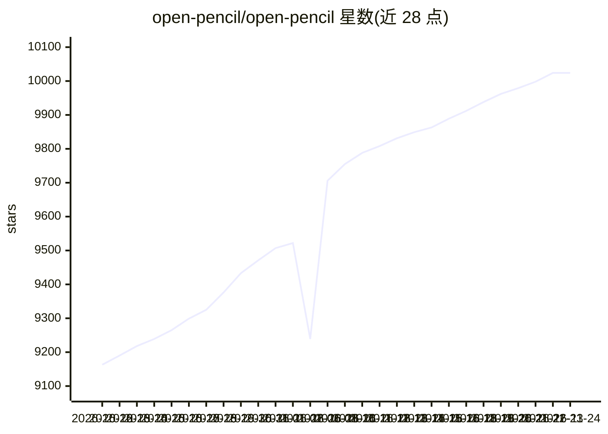

# open-pencil/open-pencil

⭐ 10,024 · TypeScript · MIT · 推送 2026-11-22 · [GitHub](https://github.com/open-pencil/open-pencil) · [官网](https://openpencil.dev) · 组织维护

**面向设计师与开发者的开源设计编辑器，可读写 .fig 文件**

基于 Vue 3、Skia WASM 与 Tauri v2 的开源设计编辑器，读取与写入 Figma 原生 .fig 文件及自有 .pen 格式。提供桌面应用（约 15 MB）与网页 PWA 两种形态。内置 AI 聊天助手带 100+ 工具可创建和修改画布节点，采用自带 API key 模式且无后端依赖。通过 headless CLI、XPath 查询、Figma Plugin API 的 eval 接口、MCP 服务器与 headless Vue SDK 实现全量可编程性。支持 WebRTC P2P 实时协作（无需服务器与账号）、组件与变体、设计转代码导出。当前处于活跃开发状态。

## 筛选速览

| 维度 | 判定 | 备注 |
|---|---|---|
| AI 角色 | `ai-enhanced` | 去掉 AI 部分产品仍成立 |
| 许可风险 | `permissive` | MIT |
| 部署形态 | `desktop` | 安装包/桌面程序 |
| 模型依赖 | locked-api |  |
| 硬件要求 | — | 无带数字的原话,不猜 |
| 安装摩擦 | `low` | 无编译、无系统依赖或容器化 |
| 成熟度 | `idea` | |

## 能力要点

- 读取并写入 Figma 原生 .fig 文件，本地优先
- 内置 AI 助手 100+ 工具修改画布，自带 key、无后端
- headless CLI + XPath + Plugin API eval + MCP 服务器
- WebRTC P2P 实时协作，含光标、跟随模式与语音通话

## 适用场景

- 在没有 Figma 订阅的环境下打开和编辑 .fig 设计文件
- 让 AI 编码代理通过 MCP 检查和修改设计文档
- 用 CLI 对设计文件做批量导出、lint 与设计 token 提取
- 团队通过分享链接进行免服务器的实时协作设计

## 场景标签

`AI 助手` · 领域:对话与助手

## 证据(README 行号)

> L9: Open-source design editor. Opens `.fig` and `.pen` design files, includes built-in AI, and ships as a programmable t
> L34: - **AI builds designs** — describe what you want in chat, 100+ tools create and modify nodes. Bring your own key fo
> L45: - **~15 MB desktop app** — Tauri v2 for macOS, Windows, Linux. Also runs in the browser as a PWA

## 星数曲线

2026-10-22 9,163 → 2026-11-24 10,024（+861）

---
*卡片 v1 · prompt 1.4 · 生成 2026-11-22 · 置信度 high · 依据 README sha `a7867569e0ec` · [字段定义](../../DATASET.md)*
