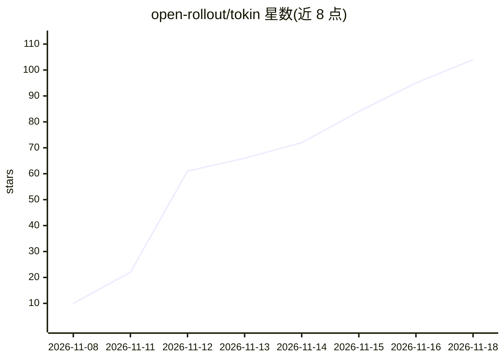

# open-rollout/tokin

⭐ 104 · Python · Apache-2.0 · 推送 2026-11-17 · [GitHub](https://github.com/open-rollout/tokin) · 组织维护

**把任意 agent harness 变成 token 级的网关，供 RL 采集 rollout**

tokin 是一个置于 agent harness 与推理引擎之间的网关：harness 侧继续用 chat completions 收发文本，引擎侧只见 token id，使每次调用均为 token-in/token-out。内部以会话树的 turn 结构维护每轮位置，训练者可收集带 token_ids、loss_mask 与 logprobs 的 rollout。支持接入 pi、Codex 等以不同 API 通信的 harness，提供 sglang 配合的快速启动流程。以 Python 包形式经 pip 安装，附 harbor_eval 与 pi_mimo_rl 示例。

## 筛选速览

| 维度 | 判定 | 备注 |
|---|---|---|
| AI 角色 | `ai-ecosystem` | LLM/agent 周边工具 |
| 许可风险 | `permissive` | Apache-2.0 |
| 部署形态 | `library` | 以包/库形式分发 |
| 模型依赖 | — | README 未给出锁定关系 |
| 硬件要求 | — | 无带数字的原话,不猜 |
| 安装摩擦 | `low` | 无编译、无系统依赖或容器化 |
| 成熟度 | — | 结构信号不足 |

## 能力要点

- harness 与推理引擎之间的 token 级网关，harness 仍用文本 chat completions
- 会话以 turn 树结构组织，每条 rollout 含 token_ids、loss_mask 与 logprobs
- 支持 pi（chat completions）与 Codex（Responses API）作为 provider 接入
- tokin open/collect 命令按会话采集训练数据

## 适用场景

- 在 agent 原生 harness 上用其真实采样 token 做 RL 训练
- 在多个 harness（pi/Codex 等）上统一收集 token 级 rollout
- 通过 Harbor 评测 mini-swe-agent、opencode、pi 或 Codex

## 场景标签

`强化学习` · 领域:训练与推理

## 证据(README 行号)

> L8:  tokin as a gateway. Harnesses, any harness, each call their own session URL with chat completions in text. Inside t
> L10: **tokin** makes any agent harness token-native. Train an agent in the harness it ships with, on exactly the tokens
> L12: text over chat completions, while the engine only ever sees token ids. tokin keeps each session as a tree of turns,

## 星数曲线

2026-11-08 10 → 2026-11-18 104（+94）

---
*卡片 v1 · prompt 1.4 · 生成 2026-11-17 · 置信度 high · 依据 README sha `ece05b854f95` · [字段定义](../../DATASET.md)*
