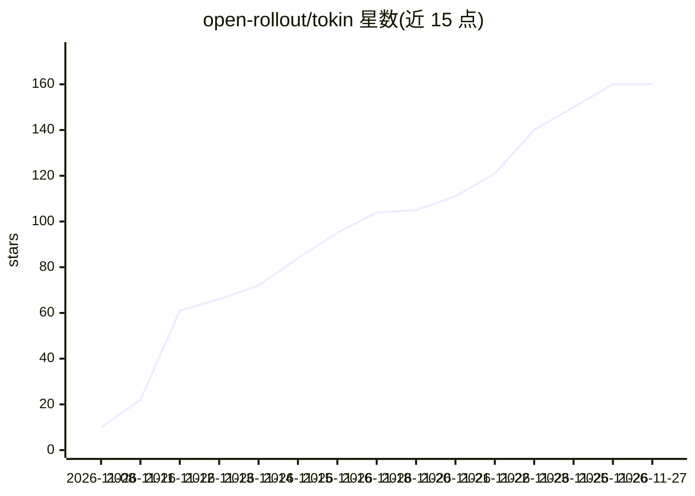

# open-rollout/tokin

⭐ 160 · Python · Apache-2.0 · 推送 2026-11-25 · [GitHub](https://github.com/open-rollout/tokin) · 组织维护

**让任意 agent harness 以 token 级会话接入推理引擎**

tokin 是一个位于 agent harness 与推理引擎之间的网关服务：harness 继续以文本方式调用 chat completions，tokin 将每轮请求映射为 token id，并把每个会话维护为 turn 树，使训练器采集的每条 rollout 在每个前缀上都是 token-in/token-out。通过 pip 安装，以 tokin serve/ open/ collect 等命令运行，输出含 token_ids、loss_mask 与 logprobs 的 JSONL rollout 数据。README 中给出 pi 与 Codex 两类 harness 的接入配置示例。

## 筛选速览

| 维度 | 判定 | 备注 |
|---|---|---|
| AI 角色 | `ai-ecosystem` | LLM/agent 周边工具 |
| 许可风险 | `permissive` | Apache-2.0 |
| 部署形态 | `library` | 以包/库形式分发 |
| 模型依赖 | — | README 未给出锁定关系 |
| 硬件要求 | — | 无带数字的原话,不猜 |
| 安装摩擦 | `low` | 无编译、无系统依赖或容器化 |
| 成熟度 | — | 结构信号不足 |

## 能力要点

- 网关模式：harness 说文本 chat completions，引擎只见 token ids
- 每个会话维护为 turn 树，支持任意前缀的 token-in/token-out
- 采集 rollout 输出 token_ids、loss_mask、logprobs 的 JSONL
- 提供 pi 与 Codex（Responses API）两类 harness 的接入配置示例

## 适用场景

- 在 harness 自带的交互模式下训练 agent，采集 token 级 rollout
- 通过 tokin 在 Harbor 上评测 mini-swe-agent、opencode、pi、Codex
- 将现有只支持文本 chat completions 的 harness 接入 sglang 等推理引擎

## 场景标签

`模型评测` `强化学习` · 领域:评测与运维

## 证据(README 行号)

> L8:  tokin as a gateway. Harnesses, any harness, each call their own session URL with chat completions in text. Inside t
> L10: **tokin** makes any agent harness token-native. Train an agent in the harness it ships with, on exactly the tokens

## 星数曲线

2026-11-08 10 → 2026-11-27 160（+150）

---
*卡片 v1 · prompt 1.4 · 生成 2026-11-27 · 置信度 high · 依据 README sha `15e953af03b4` · [字段定义](../../DATASET.md)*
