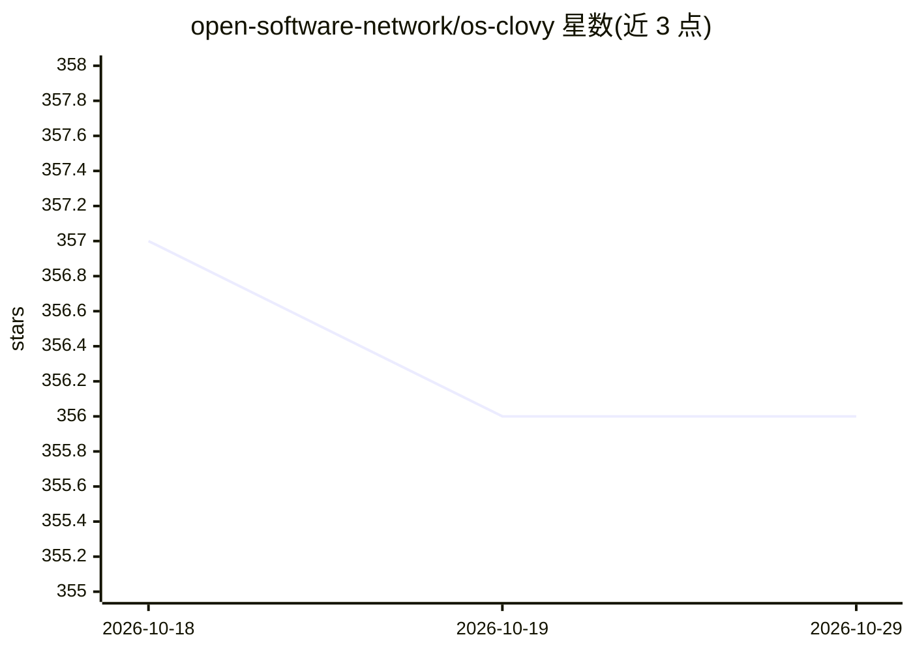

# open-software-network/os-clovy

⭐ 356 · Rust · MIT · 推送 2026-10-26 · [GitHub](https://github.com/open-software-network/os-clovy) · [官网](https://opensoftware.co/clovy) · 组织维护

**Mac 本地优先的私密 AI 工作台：聊天/听写/会议笔记/本地 agent**

基于 Tauri v2（Rust）与 React/TypeScript 的 macOS 桌面应用，把 AI 聊天、按住说话的语音听写、会议笔记（免机器人入会录制+转写+生成可编辑笔记）、基于 OpenAI Agents SDK 的本地沙箱 agent、文生图整合在一个工作区。本地优先：状态、录音、转写与 agent 记忆默认留在本机；模型调用经开源的 Clovy API（Phala Cloud 上 Intel TDX 机密 VM，TEE 可验证）路由到零保留私有模型，也可自带 Venice API key。macOS 14+ 为主目标，Windows 构建功能受限（无全局听写粘贴与系统音频采集）。MIT 许可。

## 筛选速览

| 维度 | 判定 | 备注 |
|---|---|---|
| AI 角色 | `ai-native` | 本体是模型或模型工具 |
| 许可风险 | `permissive` | MIT |
| 部署形态 | `None` |  |
| 模型依赖 | — | README 未给出锁定关系 |
| 硬件要求 | — | 无带数字的原话,不猜 |
| 安装摩擦 | `low` | 无编译、无系统依赖或容器化 |
| 成熟度 | — | 结构信号不足 |

## 能力要点

- 听写/会议转写/agent 记忆默认本地存储，agent 在 macOS write-jail 沙箱内运行
- 模型推理经 TEE 可验证的 Clovy API 路由，默认零数据保留，可自带 Venice API key
- 会议笔记无需机器人入会，录音保留以便失败步骤重试
- 模型目录按隐私层级标注，发布签名并公证

## 适用场景

- 在 Mac 上做私密 AI 聊天与研究，对话不用于训练他人模型
- 按住按键语音听写并粘贴到任意应用
- 会议录制转写并生成可编辑笔记，无需机器人入会
- 用本地沙箱 agent 处理文件、研究与草稿

## 场景标签

`AI 助手` `语音识别` `图像生成` · 领域:对话与助手

## 证据(README 行号)

> L5:  Clovy brings chat, voice dictation, meeting notes, and a local agent into a single
> L47: - **Dictation.** Hold a key, talk, release. Clovy turns your voice into clean,
> L55: - **Agent.** A Clovy-owned local agent built on the OpenAI Agents SDK that

## 星数曲线

2026-10-18 357 → 2026-10-29 356（-1）

---
*卡片 v1 · prompt 1.4 · 生成 2026-10-21 · 置信度 high · 依据 README sha `689516056e84` · [字段定义](../../DATASET.md)*
