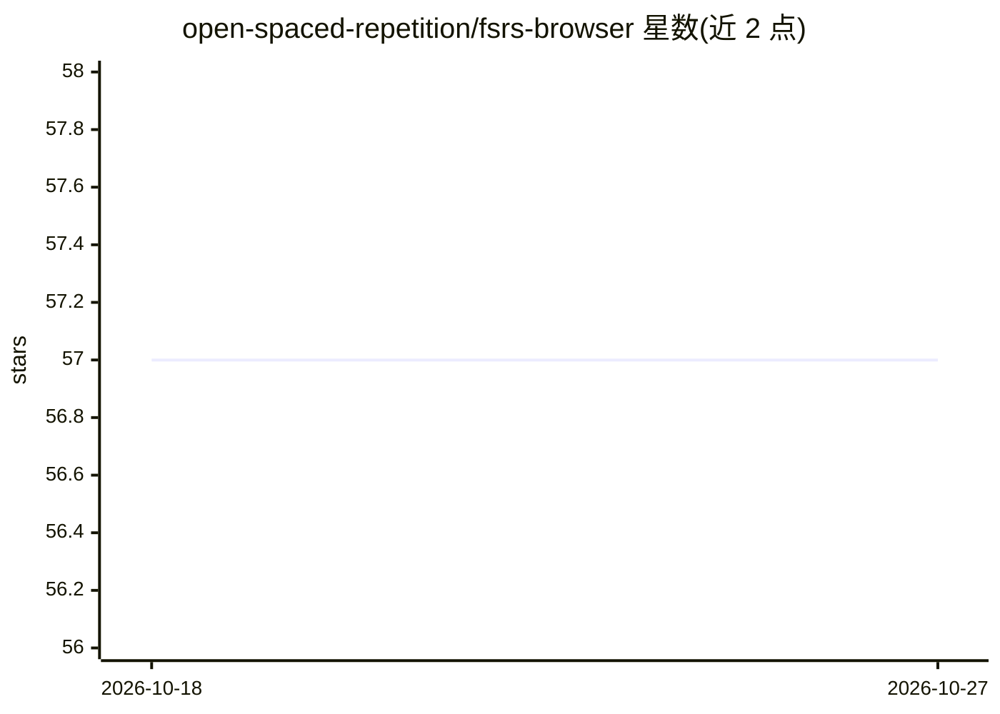

# open-spaced-repetition/fsrs-browser

⭐ 57 · Rust · BSD-3-Clause · 推送 2026-06-14 · [GitHub](https://github.com/open-spaced-repetition/fsrs-browser) · [官网](https://www.npmjs.com/package/fsrs-browser) · 组织维护

**在浏览器中运行 FSRS 间隔重复算法并训练参数的 WASM 库**

将 fsrs-rs（Rust 实现的 FSRS 间隔重复调度算法）编译为 WebAssembly 供浏览器使用，支持 FSRS 参数的训练（Optimizer）与调度计算（Scheduler）。版本号主次位与 fsrs-rs 保持一致，补丁号独立。构建通过 ./dev.sh 与 ./prod.sh 脚本完成，附 /sandbox 演示工程；README 提示训练场景应使用 ./prod.sh（dev 构建下训练 24,394 条复习记录耗时数天，prod 构建为 3.5 秒）。面向在网页端集成间隔重复调度的开发者。

## 筛选速览

| 维度 | 判定 | 备注 |
|---|---|---|
| AI 角色 | `ai-native` | 本体是模型或模型工具 |
| 许可风险 | `permissive` | BSD-3-Clause |
| 部署形态 | `None` |  |
| 模型依赖 | — | README 未给出锁定关系 |
| 硬件要求 | — | 无带数字的原话,不猜 |
| 安装摩擦 | `low` | 无编译、无系统依赖或容器化 |
| 成熟度 | — | 结构信号不足 |

## 能力要点

- 在浏览器中运行 fsrs-rs，支持 FSRS 参数训练
- 主次版本号与 fsrs-rs 保持同步
- 提供 /sandbox 演示工程与 dev/prod 构建脚本

## 适用场景

- 在网页端应用内直接运行 FSRS 调度计算
- 在浏览器中训练用户个人的 FSRS 参数

## 场景标签

 · 领域:教育/记忆算法

## 证据(README 行号)

> L5: This project runs fsrs-rs in the browser with support for training FSRS parameters.
> L3: # fsrs-browser

## 星数曲线

2026-10-18 57 → 2026-10-27 57（+0）

---
*卡片 v1 · prompt 1.4 · 生成 2026-10-24 · 置信度 mid · 依据 README sha `fa95c1e47b61` · [字段定义](../../DATASET.md)*
