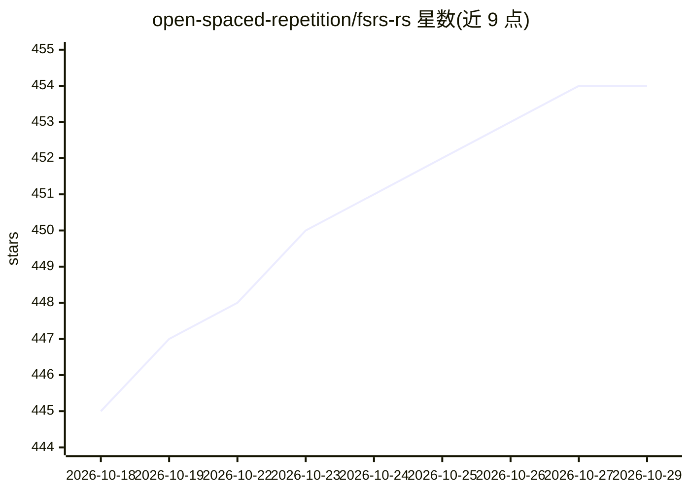

# open-spaced-repetition/fsrs-rs

⭐ 454 · Rust · BSD-3-Clause · 推送 2026-10-28 · [GitHub](https://github.com/open-spaced-repetition/fsrs-rs) · [官网](https://crates.io/crates/fsrs) · 组织维护

**FSRS 间隔重复算法的 Rust 实现：排程与参数优化**

FSRS（Free Spaced Repetition Scheduler，源自 MaiMemo DHP 模型，DSR 模型变体）的 Rust 实现，以 crate 形式提供卡片复习间隔排程、基于复习历史数据的参数优化、SM-2 数据迁移能力，以及 FSRS-6/FSRS-7 Cost ADR 单用户策略的 CPU/Rayon 训练器与模拟功能。算法细节见 FSRS wiki。区别于 rs-fsrs：仅需排程可用各语言绑定，需优化则用本 crate。另有 C/Python/Node.js/Dart/PHP 绑定仓库。

## 筛选速览

| 维度 | 判定 | 备注 |
|---|---|---|
| AI 角色 | `ai-native` | 本体是模型或模型工具 |
| 许可风险 | `permissive` | BSD-3-Clause |
| 部署形态 | `library` | 以包/库形式分发 |
| 模型依赖 | — | README 未给出锁定关系 |
| 硬件要求 | — | 无带数字的原话,不猜 |
| 安装摩擦 | `low` | 无编译、无系统依赖或容器化 |
| 成熟度 | — | 结构信号不足 |

## 能力要点

- 卡片复习间隔排程（schedule）
- 从复习日志优化 FSRS 参数（compute_parameters）
- SM-2 数据迁移（memory_state_from_sm2）
- FSRS-6/FSRS-7 Cost ADR 策略训练与模拟（CPU/Rayon）

## 适用场景

- 为自己的记忆卡片应用接入 FSRS 排程
- 用个人复习历史训练专属 FSRS 参数
- 从 SM-2 算法数据迁移到 FSRS

## 场景标签

 · 领域:记忆算法/机器学习库

## 证据(README 行号)

> L5: The Free Spaced Repetition Scheduler (FSRS) is a modern spaced repetition algorithm. It springs from MaiMemo's DHP m
> L7: FSRS-rs is a Rust implementation of FSRS. It also provides simulation capabilities and basic scheduling functionalit

## 星数曲线

2026-10-18 445 → 2026-10-29 454（+9）

---
*卡片 v1 · prompt 1.4 · 生成 2026-10-21 · 置信度 high · 依据 README sha `b09483a3b459` · [字段定义](../../DATASET.md)*
