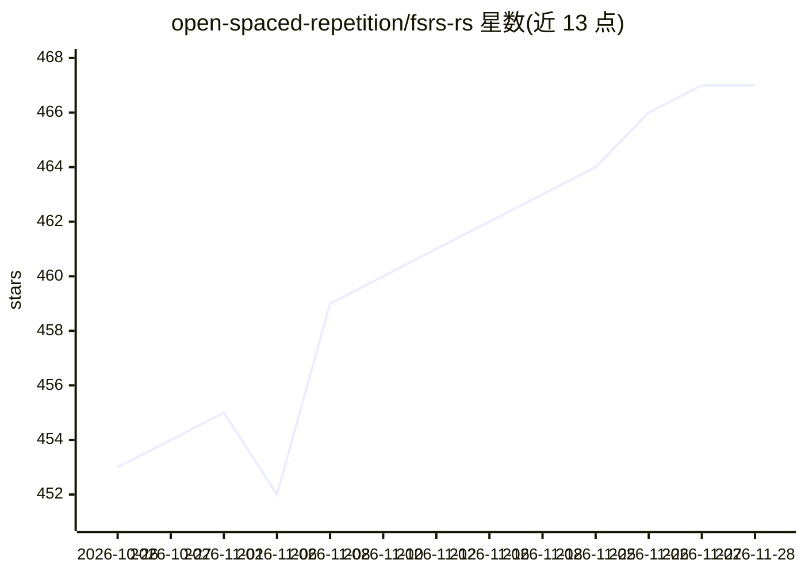

# open-spaced-repetition/fsrs-rs

⭐ 467 · Rust · BSD-3-Clause · 推送 2026-11-23 · [GitHub](https://github.com/open-spaced-repetition/fsrs-rs) · [官网](https://crates.io/crates/fsrs) · 组织维护 · 中文 README

**间隔重复算法 FSRS 的 Rust 实现（优化器+调度器）**

FSRS（Free Spaced Repetition Scheduler）算法的 Rust 实现，源自 MaiMemo 的 DHP 模型。提供基于复习记录优化记忆参数、基本调度和模拟能力，另含单用户 Cost ADR 策略训练器。通过 cargo 以 crate 形式分发，并提供 C、Python、Node.js、Dart、PHP 语言绑定。当前使用标量与 SIMD Rust 内核做推理、解析梯度做训练，无 Burn 依赖。Q&A 中说明仅调度卡片可用其他 fsrs 库，需要优化功能时使用本 crate。

## 筛选速览

| 维度 | 判定 | 备注 |
|---|---|---|
| AI 角色 | `ai-native` | 本体是模型或模型工具 |
| 许可风险 | `permissive` | BSD-3-Clause |
| 部署形态 | `library` | 以包/库形式分发 |
| 模型依赖 | — | README 未给出锁定关系 |
| 硬件要求 | — | 无带数字的原话,不猜 |
| 安装摩擦 | `low` | 无编译、无系统依赖或容器化 |
| 成熟度 | — | 结构信号不足 |

## 能力要点

- 从复习历史记录优化 FSRS 参数（支持 FSRS-6/FSRS-7）
- Cost ADR 策略训练与离线模拟（hypervolume/AUC 等报告指标）
- 从 SM-2 数据迁移记忆状态
- 提供 C/Python/Node.js/Dart/PHP 五种语言绑定

## 适用场景

- 为间隔重复应用（如 Anki 类工具）嵌入 FSRS 调度与参数优化
- 将现有 SM-2 复习数据迁移到 FSRS 参数
- 离线模拟不同期望保留率下的复习成本

## 场景标签

 · 领域:学习科学/间隔重复算法

## 证据(README 行号)

> L5: The Free Spaced Repetition Scheduler (FSRS) is a modern spaced repetition algorithm. It springs from MaiMemo's DHP m
> L7: FSRS-rs is a Rust implementation of FSRS. It also provides simulation capabilities and basic scheduling functionalit
> L49: Feed the optimizer a vector of `FSRSItem` instances built from your review history; the returned parameters can the

## 星数曲线

2026-10-26 453 → 2026-11-28 467（+14）

---
*卡片 v1 · prompt 1.4 · 生成 2026-11-25 · 置信度 high · 依据 README sha `6ac14a91ac81` · [字段定义](../../DATASET.md)*
