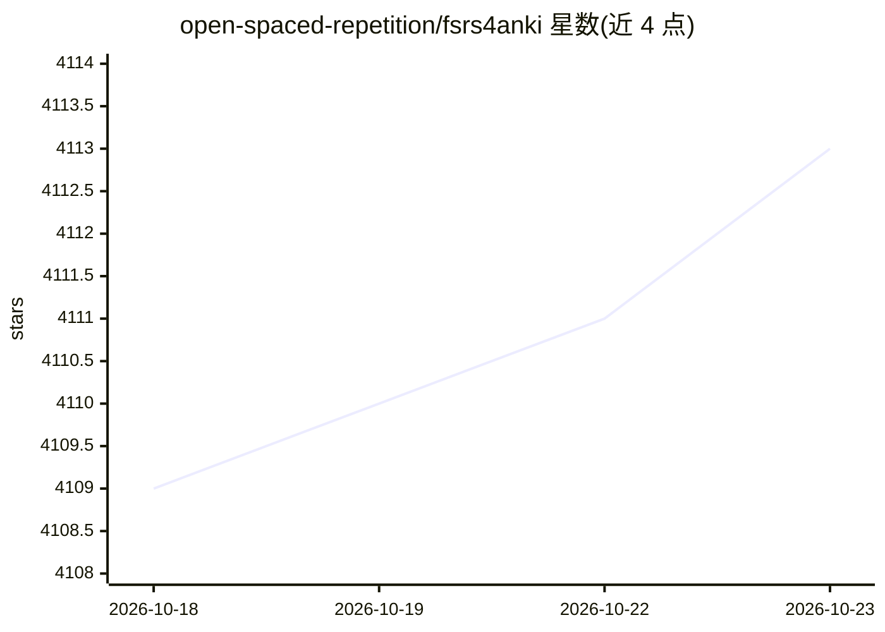

# open-spaced-repetition/fsrs4anki

⭐ 4,113 · Jupyter Notebook · MIT · 推送 2026-08-14 · [GitHub](https://github.com/open-spaced-repetition/fsrs4anki) · [官网](https://github.com/open-spaced-repetition/fsrs4anki/wiki) · 组织维护 · 中文 README

**基于 FSRS 算法的 Anki 记忆卡片间隔重复调度器与优化器**

FSRS4Anki 由两部分组成：调度器（scheduler）替换 Anki 内置调度器，按 FSRS 算法安排卡片复习间隔；优化器（optimizer）用机器学习从用户复习历史中拟合个性化记忆参数。Anki 23.10 及以上版本可按手册配置，旧版本需参考教程。README 列出与多款 Anki 插件的兼容性对照表，并说明影响卡片间隔的插件不宜与 FSRS 共用。另提供开发者资源（多语言 FSRS 实现、论文）与研究资源（数据集、研究笔记本）。墨墨背单词为项目提供研究工程师工时支持。

## 筛选速览

| 维度 | 判定 | 备注 |
|---|---|---|
| AI 角色 | `ai-native` | 本体是模型或模型工具 |
| 许可风险 | `permissive` | MIT |
| 部署形态 | `None` |  |
| 模型依赖 | — | README 未给出锁定关系 |
| 硬件要求 | — | 无带数字的原话,不猜 |
| 安装摩擦 | `low` | 无编译、无系统依赖或容器化 |
| 成熟度 | — | 结构信号不足 |

## 能力要点

- 调度器替换 Anki 内置调度器，按 FSRS 算法排程
- 优化器用机器学习从复习历史拟合个性化参数
- 提供与多款 Anki 插件的兼容性对照表
- 提供多语言 FSRS 实现、论文与数据集等开发者/研究资源

## 适用场景

- 替换 Anki 内置调度器以使用 FSRS 算法安排复习
- 基于自己的复习历史优化 FSRS 参数
- 查阅 FSRS 与现有 Anki 插件的兼容情况

## 场景标签

 · 领域:教育/记忆科学

## 证据(README 行号)

> L20: FSRS4Anki (Free Spaced Repetition Scheduler for Anki) consists of two main parts: the scheduler and the optimizer.
> L23: - The optimizer uses machine learning to learn your memory patterns and finds parameters that best fit your review 

## 星数曲线

2026-10-18 4,109 → 2026-10-23 4,113（+4）

---
*卡片 v1 · prompt 1.4 · 生成 2026-10-20 · 置信度 high · 依据 README sha `db1f0e7606b6` · [字段定义](../../DATASET.md)*
