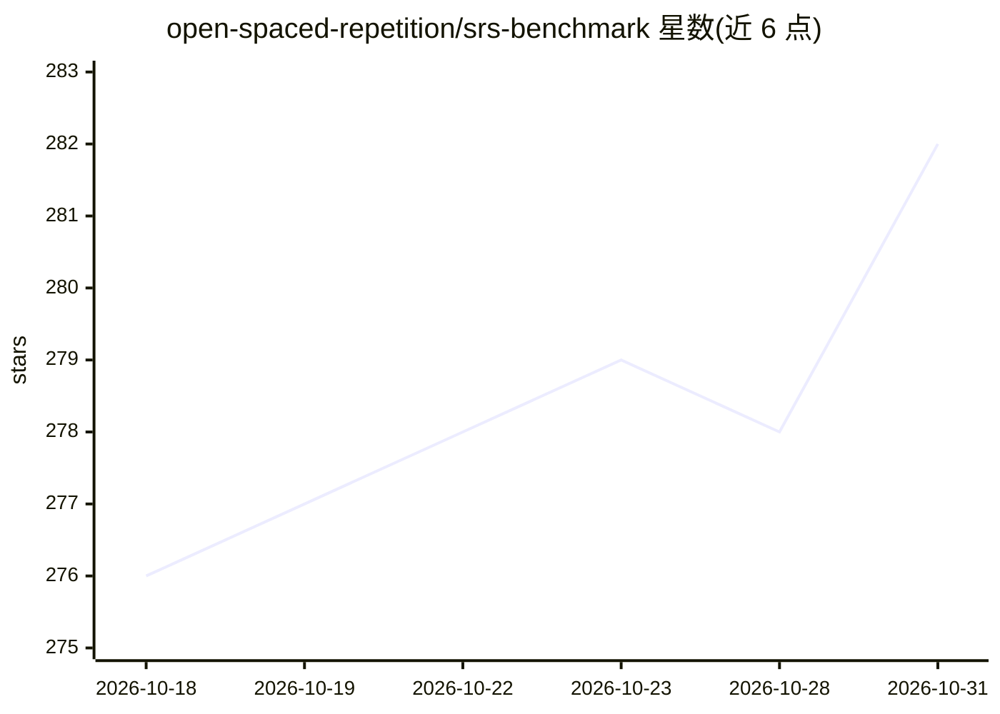

# open-spaced-repetition/srs-benchmark

⭐ 282 · Jupyter Notebook · 推送 2026-10-24 · [GitHub](https://github.com/open-spaced-repetition/srs-benchmark) · [官网](https://github.com/open-spaced-repetition/fsrs4anki/wiki) · 组织维护

**间隔重复调度算法的预测精度评测基准**

面向间隔重复（抽认卡复习排程）算法的评测基准：使用 1 万名 Anki 用户约 7.27 亿条复习记录（托管于 Hugging Face 数据集 anki-revlogs-10k），通过 sklearn 的 TimeSeriesSplit 按时间切分训练/测试数据，以 Log Loss、AUC 和自定义 RMSE(bins) 三项指标衡量算法预测回忆概率的准确度。收录 FSRS 各版本、Ebisu、HLR、DASH、ACT-R、GRU/LSTM、RWKV 等多类算法，并开放提交：可通过 GitHub issue 申请评测自己的算法。面向记忆算法研究与新算法验证场景。

## 筛选速览

| 维度 | 判定 | 备注 |
|---|---|---|
| AI 角色 | `ai-ecosystem` | LLM/agent 周边工具 |
| 许可风险 | `none` | — |
| 部署形态 | `None` |  |
| 模型依赖 | — | README 未给出锁定关系 |
| 硬件要求 | — | 无带数字的原话,不猜 |
| 安装摩擦 | `medium` | 含编译或系统依赖之一 |
| 成熟度 | — | 结构信号不足 |

## 能力要点

- 基于 1 万 Anki 用户的约 7.27 亿条复习记录构建数据集
- Log Loss / AUC / RMSE(bins) 三项评测指标，按时间切分避免数据泄漏
- 收录 FSRS 系列、Ebisu、HLR、DASH、ACT-R、GRU/LSTM、RWKV 等多族算法
- 开放提交：可通过 GitHub issue 申请评测新算法

## 适用场景

- 我想验证自己新设计的间隔重复算法的预测精度
- 比较各记忆模型在同一数据集上的表现
- 为学习类应用选择复习排程算法提供依据

## 场景标签

`模型评测` · 领域:评测与运维

## 证据(README 行号)

> L7: This benchmark is designed to assess the predictive accuracy of various algorithms. A multitude of algorithms are ev
> L29: We use three metrics in the SRS benchmark to evaluate how well these algorithms work: Log Loss, AUC, and a custom R

## 星数曲线

2026-10-18 276 → 2026-10-31 282（+6）

---
*卡片 v1 · prompt 1.4 · 生成 2026-10-22 · 置信度 high · 依据 README sha `7d314f1a0d6f` · [字段定义](../../DATASET.md)*
