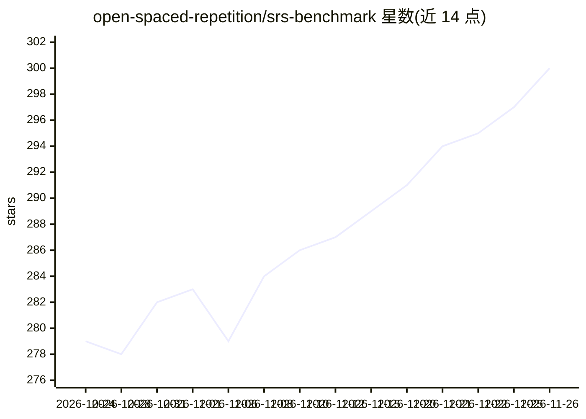

# open-spaced-repetition/srs-benchmark

⭐ 300 · Jupyter Notebook · 推送 2026-11-19 · [GitHub](https://github.com/open-spaced-repetition/srs-benchmark) · [官网](https://github.com/open-spaced-repetition/fsrs4anki/wiki) · 组织维护 · 中文 README

**评估间隔重复调度算法预测准确性的基准测试集**

该仓库提供对多种间隔重复（spaced repetition）算法的统一评估基准：使用来自约 1 万名 Anki 用户的约 7.27 亿条复习记录（托管于 Hugging Face），以 TimeSeriesSplit 按时间切分训练与测试数据，用 Log Loss、RMSE (bins) 和 AUC 三个指标衡量算法预测回忆概率的准确性。README 逐条列出被评估算法（FSRS 各版本、HLR、Ebisu、DASH、ACT-R、GRU/LSTM、RWKV、逻辑回归及基线等）并给出结果表，欢迎作者提交算法参与评估。

## 筛选速览

| 维度 | 判定 | 备注 |
|---|---|---|
| AI 角色 | `ai-knowledge` | 知识聚合/清单类 |
| 许可风险 | `none` | — |
| 部署形态 | `None` |  |
| 模型依赖 | — | README 未给出锁定关系 |
| 硬件要求 | — | 无带数字的原话,不猜 |
| 安装摩擦 | `medium` | 含编译或系统依赖之一 |
| 成熟度 | — | 结构信号不足 |

## 能力要点

- 评估约 9,999 个 Anki 用户集合、3.49 亿条复习记录
- 三项评估指标：Log Loss、RMSE (bins)、AUC
- 覆盖 FSRS 多版本、记忆模型、神经网络与基线等多类算法
- 提供数据集托管于 Hugging Face（anki-revlogs-10k）

## 适用场景

- 比较不同间隔重复算法的预测准确性
- 为新的调度算法提交基准评估
- 研究记忆/遗忘曲线模型的数据实验

## 场景标签

`模型评测` · 领域:评测与运维

## 证据(README 行号)

> L7: This benchmark is designed to assess the predictive accuracy of various algorithms. A multitude of algorithms are ev
> L29: We use three metrics in the SRS benchmark to evaluate how well these algorithms work: Log Loss, AUC, and a custom R

## 星数曲线

2026-10-24 279 → 2026-11-26 300（+21）

---
*卡片 v1 · prompt 1.4 · 生成 2026-11-25 · 置信度 mid · 依据 README sha `6b06f5153706` · [字段定义](../../DATASET.md)*
