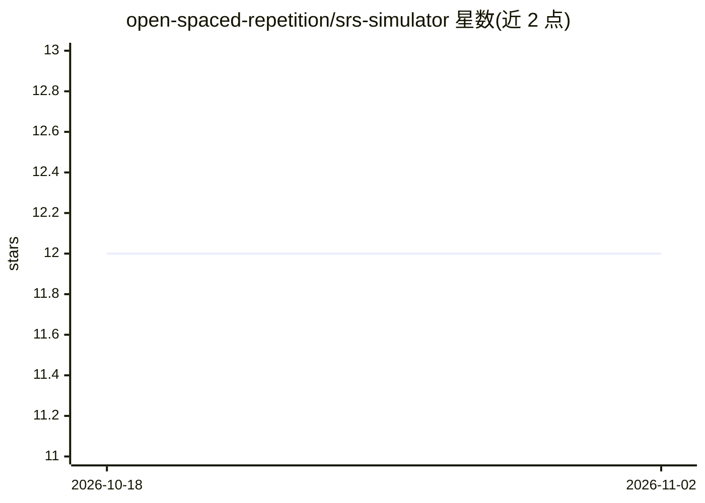

# open-spaced-repetition/srs-simulator

⭐ 12 · Python · 推送 2026-07-18 · [GitHub](https://github.com/open-spaced-repetition/srs-simulator) · 组织维护

**间隔重复调度器的双引擎模拟器，供大规模比较研究**

Python 实现的间隔重复模拟器，包含事件驱动的单用户引擎与批量张量引擎，用于在多用户规模下对调度器（FSRS 系列变体、Anki SM-2、Memrise、SSP-MMC 等）、记忆模型（FSRS/LSTM）与学习行为假设做压力测试。附带保留率扫描、Pareto 分析、基于 CMA-ES 与 SMS-EMOA 的强化学习调度器训练实验框架。依赖相邻的 srs-benchmark 与 Anki-button-usage 仓库提供权重与按钮使用数据，使用 uv 管理依赖，可选 CUDA 批量仿真。

## 筛选速览

| 维度 | 判定 | 备注 |
|---|---|---|
| AI 角色 | `ai-ecosystem` | LLM/agent 周边工具 |
| 许可风险 | `none` | — |
| 部署形态 | `None` |  |
| 模型依赖 | — | README 未给出锁定关系 |
| 硬件要求 | — | 无带数字的原话,不猜 |
| 安装摩擦 | `medium` | 含编译或系统依赖之一 |
| 成熟度 | — | 结构信号不足 |

## 能力要点

- 事件驱动引擎与批量张量引擎双架构，支持多用户大规模扫描
- 支持 FSRS6 ADR/AP 等策略的 CMA-ES 与 SMS-EMOA 训练及过拟合门控
- RL 实验流程以 TOML 配置与分阶段（preflight/train/sweep/pareto）记录驱动
- 可加载 Anki 按钮使用数据与评论按钮马尔可夫行为模拟真实学习者

## 适用场景

- 比较不同间隔重复调度器在同一学习者群体下的记忆效果
- 为 FSRS6 ADR/AP 策略做参数搜索与 Pareto 权衡分析
- 在保留率扫描中批量评估成百上千用户的模拟复习过程

## 场景标签

`模型评测` · 领域:评测与运维

## 证据(README 行号)

> L3: This project is a small, dependency-light simulator inspired by *What will a general simulator of spaced repetition 
> L22: uv run experiments/retention_sweep/run_sweep_users_batched.py --start-user 1 --end-user 200 --env lstm --sched fsrs

## 星数曲线

2026-10-18 12 → 2026-11-02 12（+0）

---
*卡片 v1 · prompt 1.4 · 生成 2026-11-01 · 置信度 high · 依据 README sha `fd2b3205d5cb` · [字段定义](../../DATASET.md)*
