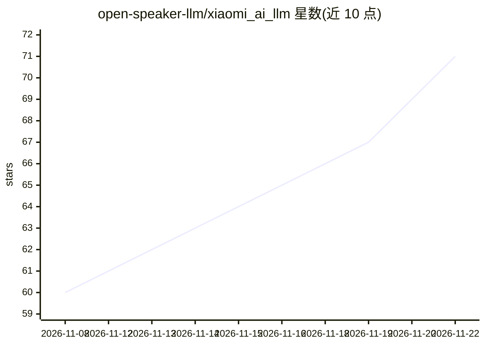

# open-speaker-llm/xiaomi_ai_llm

⭐ 71 · Shell · MIT · 推送 2026-11-10 · [GitHub](https://github.com/open-speaker-llm/xiaomi_ai_llm) · 个人维护 · 中文 README

**让老款小爱音箱直连云端大模型问答的客户端**

运行在小米 AI 音箱 MDZ-25-DA（S12A）上的客户端：复用小爱原生的唤醒、识别与家电控制，开放问题由音箱直接调用云端大模型（DeepSeek/GLM/Kimi/MiniMax 或 OpenAI 兼容接口），回答经在线 EdgeTTS 播出，播完进入免唤醒追问窗口。模型不在音箱上运行，断网后仅剩小爱原生能力。安装需拆机接串口、建立 SSH 并可能修改系统分区，只实测过这一款机型；支持 DeepSeek 联网搜索。可选 FastAPI 服务端用于 TTS 与回退。

## 筛选速览

| 维度 | 判定 | 备注 |
|---|---|---|
| AI 角色 | `ai-native` | 本体是模型或模型工具 |
| 许可风险 | `permissive` | MIT |
| 部署形态 | `None` |  |
| 模型依赖 | locked-api |  |
| 硬件要求 | — | 无带数字的原话,不猜 |
| 安装摩擦 | `low` | 无编译、无系统依赖或容器化 |
| 成熟度 | `idea` | |

## 能力要点

- 音箱端客户端直连云端 LLM，无需中转服务器或电脑常驻
- 保留小爱原生识别与家电控制，按规则分流（native-first）
- 免唤醒追问与 boot1 首轮停顿续说
- 支持 DeepSeek 官方 Search/Fetch 联网搜索

## 适用场景

- 让家里闲置的老款小爱音箱回答开放性问题
- 音箱问答时家电控制不受影响，边播报边开灯
- 免唤醒连续追问对话

## 场景标签

`语音 Agent` · 领域:对话与助手

## 证据(README 行号)

> L14: **一句话定义：** 这是跑在小米 AI 音箱 MDZ-25-DA（系统代号 S12A）上的客户端：开灯、天气等小爱能处理的仍走小爱，开放问题由音箱直连云端大模型，再用在线 EdgeTTS 念出来。大模型不在音箱上运行，断网后不能

## 星数曲线

2026-11-08 60 → 2026-11-22 71（+11）

---
*卡片 v1 · prompt 1.4 · 生成 2026-11-18 · 置信度 mid · 依据 README sha `9cc7005bc23e` · [字段定义](../../DATASET.md)*
