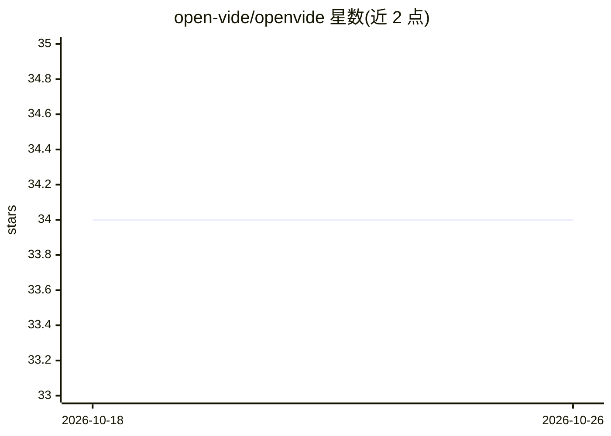

# open-vide/openvide

⭐ 34 · TypeScript · MIT · 推送 2026-07-06 · [GitHub](https://github.com/open-vide/openvide) · [官网](https://openvide.com) · 组织维护

**移动端远程管理 Claude Code/Codex 会话的 SSH 守护进程与客户端套件**

OpenVide 是 monorepo，包含 React Native 移动应用、浏览器/眼镜 webview 客户端和全局安装的 openvide-daemon。守护进程通过 SSH 管理远程主机上的 Claude Code 与 Codex 交互式会话，持久化会话历史并流式输出；可选 HTTPS/WebSocket 桥为浏览器客户端提供接入，并暴露 OpenAI 兼容的 /v1/chat/completions 端点路由到 Claude/Codex/Gemini 会话。还提供团队编排（成员会话、任务板）、cron 定时任务与 VPS 一键部署命令。限制：桥默认使用自签名证书，浏览器接入需信任证书或经反向代理；部分眼镜端控件未接通 RPC。

## 筛选速览

| 维度 | 判定 | 备注 |
|---|---|---|
| AI 角色 | `ai-ecosystem` | LLM/agent 周边工具 |
| 许可风险 | `permissive` | MIT |
| 部署形态 | `library` | 以包/库形式分发 |
| 模型依赖 | locked-api |  |
| 硬件要求 | — | 无带数字的原话,不猜 |
| 安装摩擦 | `low` | 无编译、无系统依赖或容器化 |
| 成熟度 | — | 结构信号不足 |

## 能力要点

- daemon 通过 SSH/Unix socket 管理远程主机上的 Claude/Codex 进程
- OpenAI 兼容 /v1/chat/completions 桥接端点，路由到 Claude/Codex/Gemini
- 团队编排：成员会话、团队聊天、任务板与自动推进的任务执行
- cron 定时任务可定向 prompt 会话或团队调度

## 适用场景

- 在手机上管理和继续远程服务器上的 Claude Code/Codex 会话
- 把 Claude/Codex 会话以 OpenAI 兼容 API 暴露给 Even AI 等自定义 agent
- 在自有 VPS 上自托管并一键部署 systemd + Caddy/nginx 拓扑

## 场景标签

`编码 Agent` `模型网关` · 领域:Agent 开发

## 证据(README 行号)

> L7:  Open source remote control for Claude Code, Codex, and team automation over SSH and an optional HTTPS bridge.
> L26: - Even AI compatible `/v1/chat/completions` routing
> L60:   -> daemon-managed Claude/Codex process

## 星数曲线

2026-10-18 34 → 2026-10-26 34（+0）

---
*卡片 v1 · prompt 1.4 · 生成 2026-10-25 · 置信度 high · 依据 README sha `f13687c5fb19` · [字段定义](../../DATASET.md)*
