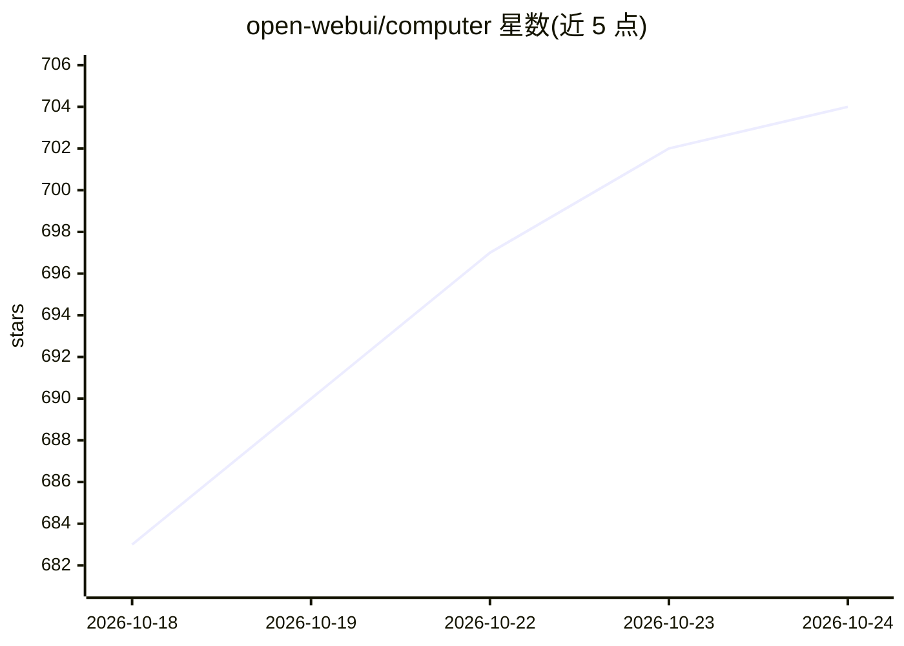

# open-webui/computer

⭐ 708 · Python · NOASSERTION · 推送 2026-08-17 · [GitHub](https://github.com/open-webui/computer) · [官网](https://openwebui.com/computer) · 组织维护 · 中文 README

**把整台电脑（文件/终端/git/AI agent）服务到任意浏览器**

运行在用户本机、通过浏览器向手机/平板/笔记本提供完整工作站界面的工具：文件管理、语法高亮编辑器、git 图形操作、浏览器内终端、Chrome 浏览、多工作区与会话持久化。AI 部分支持自带 API key（OpenAI/Anthropic/Ollama 等）或接入已订阅的编码 agent（Codex、Claude Code、Cursor 等），可读写文件、执行命令、浏览网页、启动子 agent，并将每个工作区暴露为 OpenAI 兼容的 /v1/chat/completions 端点。支持 Docker 与离线安装；安全模型等同开放 SSH 端口，无路径沙箱与用户隔离。

## 筛选速览

| 维度 | 判定 | 备注 |
|---|---|---|
| AI 角色 | `ai-enhanced` | 去掉 AI 部分产品仍成立 |
| 许可风险 | `none` | NOASSERTION |
| 部署形态 | `self-host` | docker 或自建部署 |
| 模型依赖 | local-ok | 支持本地模型 |
| 硬件要求 | — | 无带数字的原话,不猜 |
| 安装摩擦 | `low` | 无编译、无系统依赖或容器化 |
| 成熟度 | — | 结构信号不足 |

## 能力要点

- 浏览器内完整工作站：文件、编辑器、git、终端、多工作区、会话持久化
- AI agent 可读写文件、执行命令、浏览网页并启动并行子 agent
- 每个工作区可暴露为 OpenAI 兼容 Gateway API 供任意客户端调用
- 支持 Docker 部署与离线（air-gapped）安装

## 适用场景

- 在手机或平板上远程操作自己的开发机做编码、git 与运维
- 把已有编码 agent 订阅（Codex/Claude Code 等）接到本机工作区
- 通过 Telegram/Discord 等聊天软件远程指挥电脑执行任务

## 场景标签

`编码 Agent` `模型网关` · 领域:Agent 开发

## 证据(README 行号)

> L14: Open WebUI Computer (`cptr`) runs on your machine and serves your whole computer to any browser: files, terminal, e
> L143: **Computer, not chat.** The core is the filesystem, the terminal, and git. Files over apps. Plain files on your ma
> L78: Bring your own API key (OpenAI, Anthropic, Ollama, or any OpenAI-compatible endpoint), or connect a coding agent yo

## 星数曲线

2026-10-18 683 → 2026-10-24 704（+21）

---
*卡片 v1 · prompt 1.4 · 生成 2026-10-21 · 置信度 high · 依据 README sha `ad1cbd43c010` · [字段定义](../../DATASET.md)*
