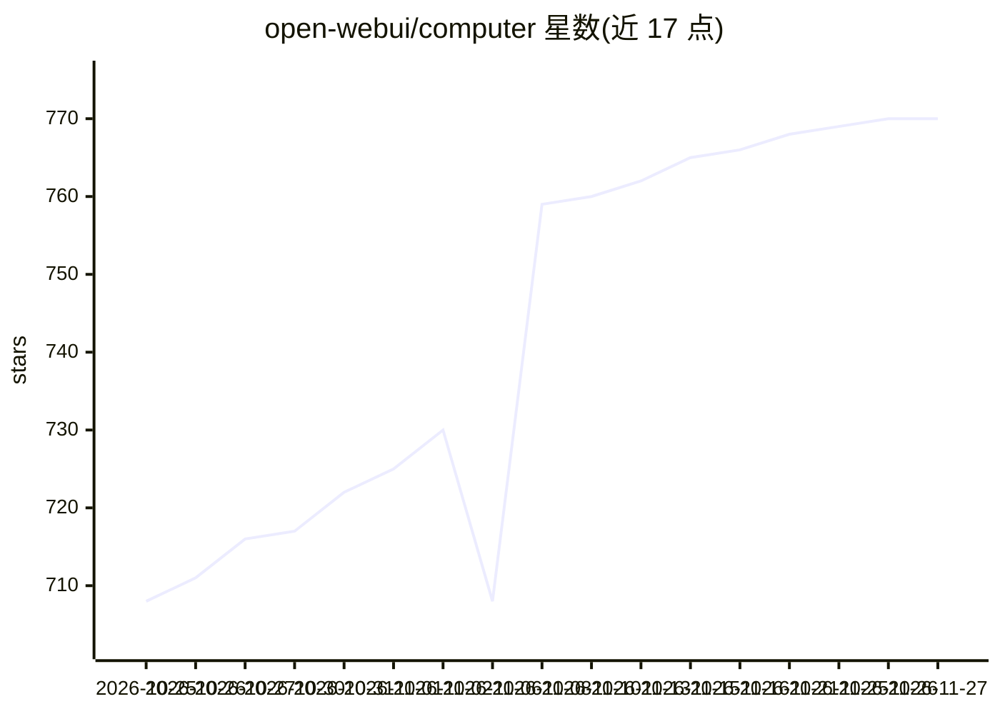

# open-webui/computer

⭐ 770 · Python · NOASSERTION · 推送 2026-11-21 · [GitHub](https://github.com/open-webui/computer) · [官网](https://openwebui.com/computer) · 组织维护

**在浏览器中远程操作自己机器的文件与终端工作区**

Open WebUI Computer（命令名 cptr）以 pip 包形式提供，在本地机器上运行后开放一个浏览器工作区，用户可远程编辑文件、查看 Git 变更、运行 shell 或编码 agent，关闭浏览器标签后终端会话保持运行。README 建议新部署将其与 Open WebUI 及 Open Terminal 组合使用，使 AI 能在对话中编辑项目文件并执行命令。README 提示：任何登录者拥有对文件与 shell 的完全访问权限，需自行保持访问私有。

## 筛选速览

| 维度 | 判定 | 备注 |
|---|---|---|
| AI 角色 | `ai-ecosystem` | LLM/agent 周边工具 |
| 许可风险 | `none` | NOASSERTION |
| 部署形态 | `library` | 以包/库形式分发 |
| 模型依赖 | — | README 未给出锁定关系 |
| 硬件要求 | — | 无带数字的原话,不猜 |
| 安装摩擦 | `low` | 无编译、无系统依赖或容器化 |
| 成熟度 | — | 结构信号不足 |

## 能力要点

- pip 安装 cptr 后一条命令启动，浏览器打开即用
- 远程编辑文件、查看 Git 变更、运行 shell 与编码 agent
- 关闭标签后终端会话持续运行
- 可与 Open WebUI + Open Terminal 组合，AI 在对话中操作文件与命令

## 适用场景

- 在浏览器中远程操作自己机器上的终端与文件
- 让 Open WebUI 中的 AI 编辑项目文件并执行 shell 命令
- 长时间运行的终端任务在断开浏览器后继续执行

## 场景标签

`编码 Agent` · 领域:编码与开发

## 证据(README 行号)

> L3: **For new setups, we recommend Open WebUI with Open Terminal.** Your AI can edit project files and run shell command
> L9: Open WebUI Computer (`cptr`) lets you edit files, review Git changes, and run a shell or coding agent on your own ma

## 星数曲线

2026-10-25 708 → 2026-11-27 770（+62）

---
*卡片 v1 · prompt 1.4 · 生成 2026-11-24 · 置信度 mid · 依据 README sha `1033020d1743` · [字段定义](../../DATASET.md)*
