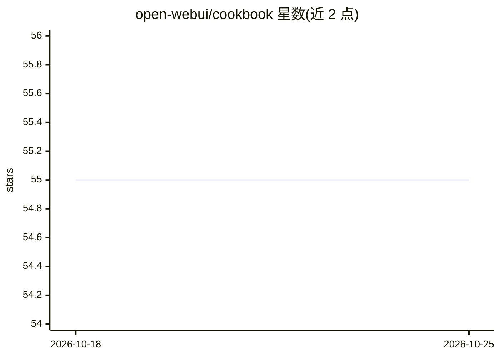

# open-webui/cookbook

⭐ 54 · Jupyter Notebook · 推送 2026-05-04 · [GitHub](https://github.com/open-webui/cookbook) · 组织维护

**Open WebUI 官方示例集：提供用法食谱与集成示例**

名为 Open WebUI Cookbook 的仓库，README 仅一行标题，描述为 we're cooking。从仓库名可判断其收录 Open WebUI（自托管 LLM Web 界面）相关的使用配方与示例。README 未提供安装说明、目录结构或使用方式等可验证信息，具体内容与条目数量不可见，需查阅仓库实际文件确认。

## 筛选速览

| 维度 | 判定 | 备注 |
|---|---|---|
| AI 角色 | `ai-ecosystem` | LLM/agent 周边工具 |
| 许可风险 | `none` | — |
| 部署形态 | `None` |  |
| 模型依赖 | — | README 未给出锁定关系 |
| 硬件要求 | — | 无带数字的原话,不猜 |
| 安装摩擦 | `low` | 无编译、无系统依赖或容器化 |
| 成熟度 | — | 结构信号不足 |

## 能力要点

- 仓库归属 open-webui 官方组织
- 名称表明为示例/配方集合

## 适用场景

- 查找 Open WebUI 的用法示例与集成配方

## 场景标签

`教程课程` · 领域:学习与行业

## 证据(README 行号)

> L1: # Open WebUI Cookbook

## 星数曲线

2026-10-18 55 → 2026-10-25 55（+0）

---
*卡片 v1 · prompt 1.4 · 生成 2026-10-24 · 置信度 low · 依据 README sha `48c2c6a2821f` · [字段定义](../../DATASET.md)*
