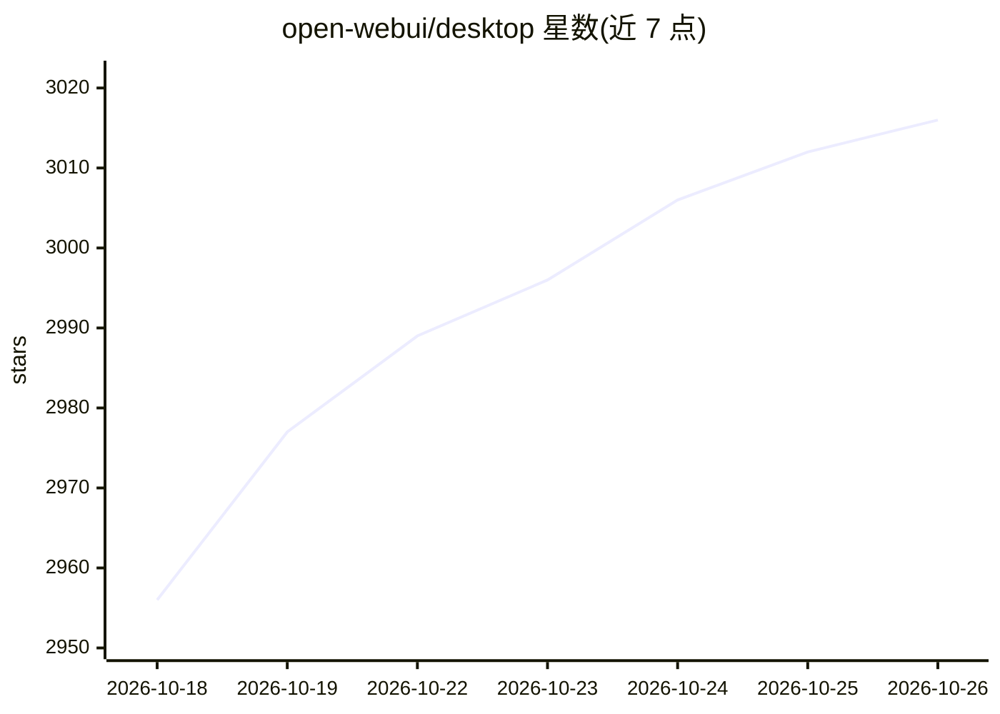

# open-webui/desktop

⭐ 3,016 · Svelte · AGPL-3.0 · 推送 2026-05-06 · [GitHub](https://github.com/open-webui/desktop) · [官网](https://openwebui.com) · 组织维护

**Open WebUI 桌面原生应用：本地跑模型或连接远程服务器聊天**

Open WebUI 的原生桌面客户端，以安装包形式分发（macOS/Windows/Linux 多架构）。本地模式将 Open WebUI 运行在本机，可选启用内置 llama.cpp 引擎下载并离线运行模型；远程模式可连接任意 Open WebUI 服务器并在多连接间切换。功能包括 Spotlight 悬浮聊天栏（可拖拽截图）、系统级按键说话语音输入（转写后发送至对话）、自动更新与离线可用。首次启动需联网，无遥测。项目自述处于 Early Alpha 阶段。

## 筛选速览

| 维度 | 判定 | 备注 |
|---|---|---|
| AI 角色 | `ai-native` | 本体是模型或模型工具 |
| 许可风险 | `viral` | AGPL-3.0 |
| 部署形态 | `desktop` | 安装包/桌面程序 |
| 模型依赖 | — | README 未给出锁定关系 |
| 硬件要求 | — | 无带数字的原话,不猜 |
| 安装摩擦 | `low` | 无编译、无系统依赖或容器化 |
| 成熟度 | `idea` | |

## 能力要点

- 内置 llama.cpp 引擎，可选完全离线本地推理
- Spotlight 悬浮聊天栏，全局快捷键呼出并支持屏幕截图
- 系统级 push-to-talk 语音输入并自动转写发送
- 多远程服务器连接管理，本地/远程可同时使用

## 适用场景

- 在桌面上一键安装即用 Open WebUI，无需 Docker 或终端
- 离线运行本地模型进行私密对话
- 连接公司或家庭服务器上的 Open WebUI 实例并多连接切换

## 场景标签

`聊天机器人` `AI 助手` · 领域:对话与助手

## 证据(README 行号)

> L10: Your AI, right on your desktop. Open WebUI as a native app. Run models locally or connect to any server. No Docker,
> L34: 🖥️ **Run locally.** The app runs Open WebUI on your machine. You can optionally enable the built-in llama.cpp engin

## 星数曲线

2026-10-18 2,956 → 2026-10-26 3,016（+60）

---
*卡片 v1 · prompt 1.4 · 生成 2026-10-20 · 置信度 high · 依据 README sha `ac2e43a10a8f` · [字段定义](../../DATASET.md)*
