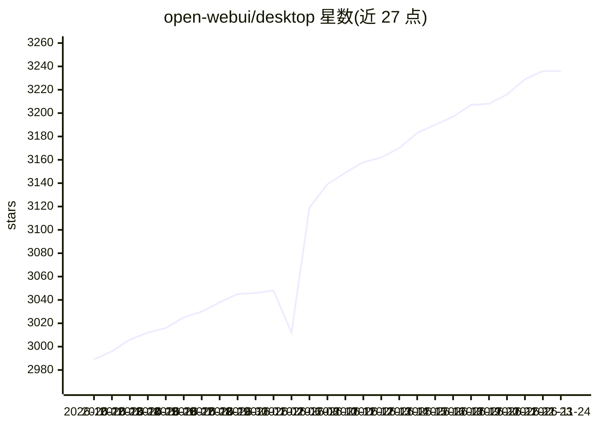

# open-webui/desktop

⭐ 3,236 · Svelte · AGPL-3.0 · 推送 2026-11-02 · [GitHub](https://github.com/open-webui/desktop) · [官网](https://openwebui.com) · 组织维护

**把 Open WebUI 一键安装到桌面的安装器应用**

Open WebUI 的桌面端发行：以桌面安装包形式把 Open WebUI 安装到本机，负责安装、启动与自动更新，并在应用内打开界面。本地运行用户自己的 Open WebUI 副本，支持 macOS（Apple Silicon/Intel）、Windows（x64/ARM64）与 Linux（.deb/AppImage/Snap/Flatpak）多种包格式；磁盘需求 5 GB+，安装与更新需联网，声明不收集使用数据。若需连接外部 AI 服务商，适用该服务商的隐私政策。

## 筛选速览

| 维度 | 判定 | 备注 |
|---|---|---|
| AI 角色 | `ai-ecosystem` | LLM/agent 周边工具 |
| 许可风险 | `viral` | AGPL-3.0 |
| 部署形态 | `desktop` | 安装包/桌面程序 |
| 模型依赖 | — | README 未给出锁定关系 |
| 硬件要求 | — | 无带数字的原话,不猜 |
| 安装摩擦 | `low` | 无编译、无系统依赖或容器化 |
| 成熟度 | — | 结构信号不足 |

## 能力要点

- 覆盖 macOS/Windows/Linux 的桌面安装包与自动更新机制
- 本地运行 Open WebUI 副本，含 .deb/AppImage/Snap/Flatpak 多种发行格式
- 声明不收集使用数据

## 适用场景

- 在个人电脑上快速安装并更新 Open WebUI
- 本地管理 Open WebUI 而不依赖远程服务器
- 需要 AppImage、Snap 等多种 Linux 安装方式时选择合适的包

## 场景标签

 · 领域:开发者工具/桌面应用

## 证据(README 行号)

> L10: Open WebUI, up and running in a few clicks. Desktop installs it on your computer, keeps it up to date, and opens it
> L29: Open the app and click **Get Started**. Desktop installs Open WebUI on your computer, starts it for you, and opens 
> L31: Desktop runs your own local copy of Open WebUI. If you already use Open WebUI on another server, Open WebUI Tether 

## 星数曲线

2026-10-22 2,989 → 2026-11-24 3,236（+247）

---
*卡片 v1 · prompt 1.4 · 生成 2026-11-23 · 置信度 high · 依据 README sha `36b112343af1` · [字段定义](../../DATASET.md)*
