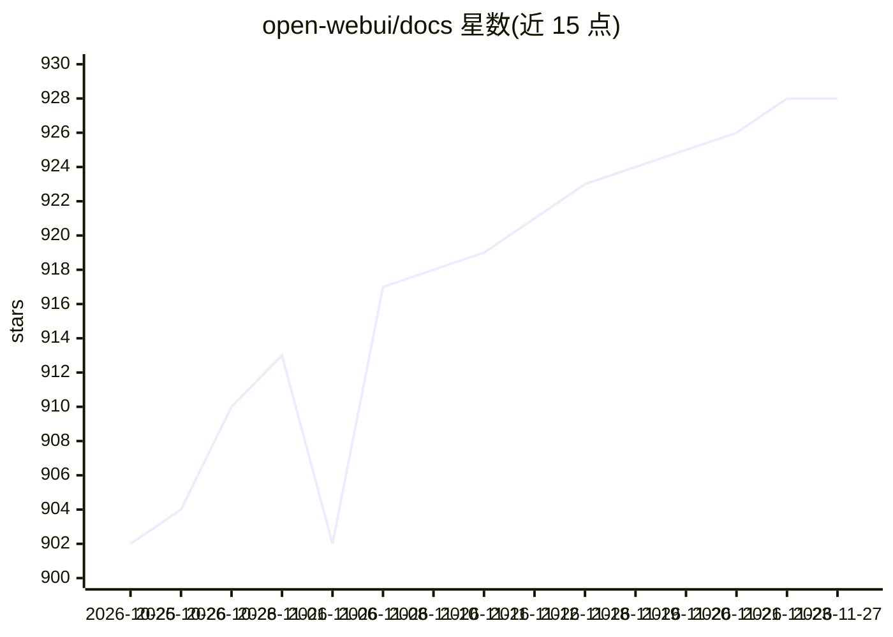

# open-webui/docs

⭐ 928 · JavaScript · 推送 2026-11-26 · [GitHub](https://github.com/open-webui/docs) · [官网](https://docs.openwebui.com) · 组织维护

**Open WebUI 的文档站点源码与构建流程**

docs.openwebui.com 的文档仓库，使用 Docusaurus 构建。README 仅描述贡献者工作流：安装 .node-version 指定的 Node.js 版本，通过 npm ci 与 npm start 本地运行站点，编辑 docs/ 目录下的页面，npm run build 校验生产构建后提交 pull request，并指向 contributing guide。README 未包含 Open WebUI 产品本身的功能、安装或使用说明，仅面向参与文档编写的人员。

## 筛选速览

| 维度 | 判定 | 备注 |
|---|---|---|
| AI 角色 | `ai-knowledge` | 知识聚合/清单类 |
| 许可风险 | `none` | — |
| 部署形态 | `None` |  |
| 模型依赖 | — | README 未给出锁定关系 |
| 硬件要求 | — | 无带数字的原话,不猜 |
| 安装摩擦 | `low` | 无编译、无系统依赖或容器化 |
| 成熟度 | — | 结构信号不足 |

## 能力要点

- Docusaurus 构建的文档站点源码
- npm ci + npm start 本地运行文档
- npm run build 校验生产构建

## 适用场景

- 为 Open WebUI 文档贡献或修改页面
- 本地预览文档站点效果

## 场景标签

 · 领域:文档/开发者工具

## 证据(README 行号)

> L3: Source for docs.openwebui.com, built with Docusaurus.
> L5: Use the Node.js version in .node-version, then run:

## 星数曲线

2026-10-25 902 → 2026-11-27 928（+26）

---
*卡片 v1 · prompt 1.4 · 生成 2026-11-24 · 置信度 high · 依据 README sha `c4b532e789a5` · [字段定义](../../DATASET.md)*
