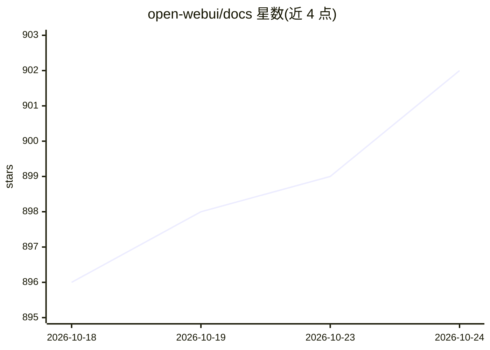

# open-webui/docs

⭐ 902 · JavaScript · 推送 2026-10-24 · [GitHub](https://github.com/open-webui/docs) · [官网](https://docs.openwebui.com) · 组织维护

**Open WebUI 官方文档站：部署、插件、API 与 RAG 使用指南**

基于 Docusaurus 构建的 Open WebUI 官方文档仓库，覆盖安装与配置指南（Docker、本地、手动方式）、插件与扩展文档、API 参考与 pipeline 用法、文件上传与 RAG 集成说明，以及开发者贡献指南。面向 Open WebUI 的用户与贡献者，文档站发布于 docs.openwebui.com。本仓库为文档源码，非 Open WebUI 软件本体。

## 筛选速览

| 维度 | 判定 | 备注 |
|---|---|---|
| AI 角色 | `ai-ecosystem` | LLM/agent 周边工具 |
| 许可风险 | `none` | — |
| 部署形态 | `None` |  |
| 模型依赖 | — | README 未给出锁定关系 |
| 硬件要求 | — | 无带数字的原话,不猜 |
| 安装摩擦 | `low` | 无编译、无系统依赖或容器化 |
| 成熟度 | — | 结构信号不足 |

## 能力要点

- Docker、本地、手动三种安装路径的指南
- 插件/扩展与 pipeline 用法文档
- 文件上传与 RAG 集成说明

## 适用场景

- 查阅 Open WebUI 的安装与配置方法
- 了解插件、pipeline 与 RAG 功能的用法
- 参与文档贡献

## 场景标签

 · 领域:LLM 基础设施/文档

## 证据(README 行号)

> L3: Welcome to the official documentation for **Open WebUI** — a self-hosted, privacy-focused, and extensible AI interfa
> L7: - 🔧 Installation & setup guides (Docker, local, manual)

## 星数曲线

2026-10-18 896 → 2026-10-24 902（+6）

---
*卡片 v1 · prompt 1.4 · 生成 2026-10-21 · 置信度 mid · 依据 README sha `6b68c8f19444` · [字段定义](../../DATASET.md)*
