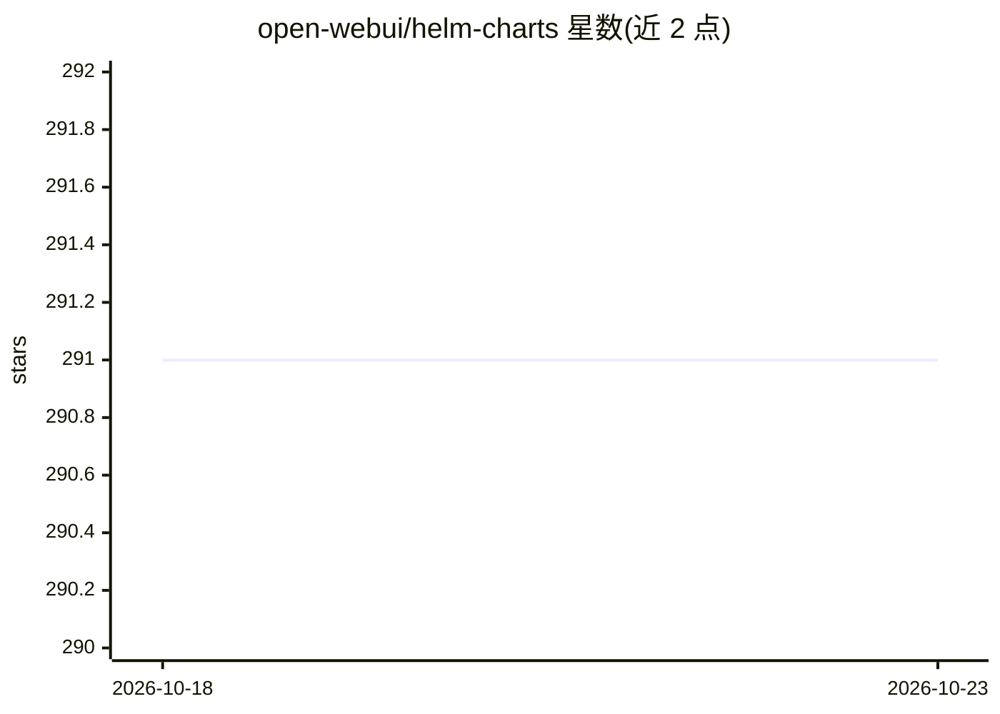

# open-webui/helm-charts

⭐ 291 · Go Template · 推送 2026-10-22 · [GitHub](https://github.com/open-webui/helm-charts) · 组织维护

**Open WebUI 的 Helm Chart，用于 Kubernetes 部署**

提供 Open WebUI 应用在 Kubernetes 上的 Helm Chart 分发：Chart 托管于 https://helm.openwebui.com，通过 helm repo add 添加仓库后即可安装。支持通过覆盖 image.tag=dev 测试开发版镜像，dev chart 预发布版在 dev 镜像可用后自动发布，可用 --devel 标志安装。面向在 Kubernetes 环境中部署 Open WebUI（一个面向 LLM 的 Web 交互界面）的运维或开发者。

## 筛选速览

| 维度 | 判定 | 备注 |
|---|---|---|
| AI 角色 | `ai-ecosystem` | LLM/agent 周边工具 |
| 许可风险 | `none` | — |
| 部署形态 | `library` | 以包/库形式分发 |
| 模型依赖 | — | README 未给出锁定关系 |
| 硬件要求 | — | 无带数字的原话,不猜 |
| 安装摩擦 | `low` | 无编译、无系统依赖或容器化 |
| 成熟度 | — | 结构信号不足 |

## 能力要点

- Chart 托管于 helm.openwebui.com 官方 Helm 仓库
- 支持以 image.tag=dev 覆盖测试 dev 镜像
- dev chart 预发布版随 dev 镜像自动发布

## 适用场景

- 在 Kubernetes 集群上部署 Open WebUI
- 用 dev 镜像或 --devel 预发布 chart 测试开发版

## 场景标签

 · 领域:LLM 基础设施/部署

## 证据(README 行号)

> L1: # Open WebUI Helm Charts
> L2: Helm charts for the Open WebUI application.

## 星数曲线

2026-10-18 291 → 2026-10-23 291（+0）

---
*卡片 v1 · prompt 1.4 · 生成 2026-10-22 · 置信度 high · 依据 README sha `42725efde851` · [字段定义](../../DATASET.md)*
