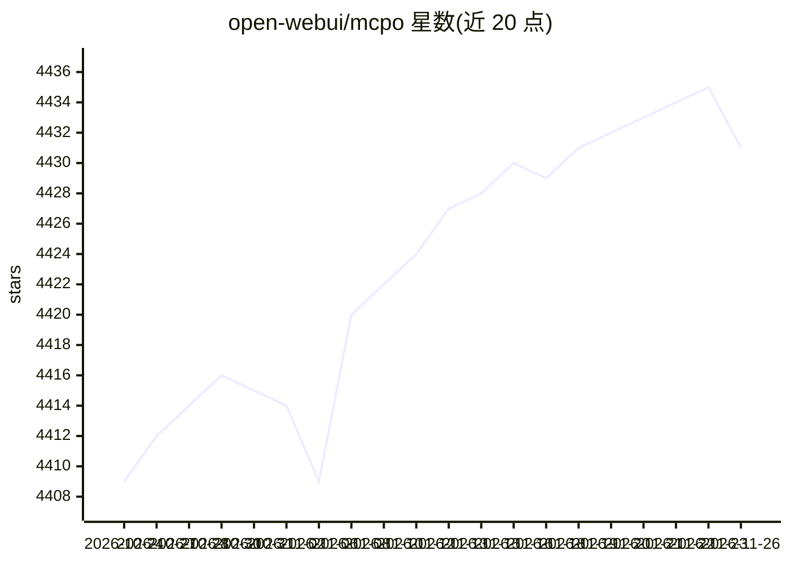

# open-webui/mcpo

⭐ 4,431 · Python · MIT · 推送 2026-11-25 · [GitHub](https://github.com/open-webui/mcpo) · [官网](https://docs.openwebui.com/features/plugin/tools/openapi-servers/mcp) · 组织维护

**把 MCP 服务器工具转成 OpenAPI HTTP 接口的代理服务**

mcpo 是一个 MCP 到 OpenAPI 的代理服务器：为任意 MCP server 启动进程并在其前提供标准 HTTP 服务，每个工具获得独立端点、OpenAPI schema 与 /docs 交互文档，支持 API key 鉴权。支持 stdio、SSE 与 streamable-http 三类服务器，可通过配置文件（Claude Desktop 格式）聚合多个 MCP 服务器并热重载，支持 OAuth 2.1 动态客户端注册。提供 pip/uvx 安装与 Docker 镜像，MIT 许可。

## 筛选速览

| 维度 | 判定 | 备注 |
|---|---|---|
| AI 角色 | `ai-ecosystem` | LLM/agent 周边工具 |
| 许可风险 | `permissive` | MIT |
| 部署形态 | `self-host` | docker 或自建部署 |
| 模型依赖 | — | README 未给出锁定关系 |
| 硬件要求 | — | 无带数字的原话,不猜 |
| 安装摩擦 | `low` | 无编译、无系统依赖或容器化 |
| 成熟度 | — | 结构信号不足 |

## 能力要点

- 将 MCP 工具转换为带交互文档的标准 OpenAPI HTTP 端点
- 支持 stdio/SSE/streamable-http 三类 MCP 服务器代理
- 配置文件聚合多服务器并支持热重载
- OAuth 2.1 支持与 API key 鉴权（--strict-auth 保护文档）

## 适用场景

- 让浏览器或远程机器上的应用通过 HTTP 访问本地 stdio MCP 服务器
- 在 Open WebUI 中接入仅支持 stdio/SSE 的 MCP 工具
- 用一个实例统一管理并暴露多个 MCP 服务器
- 为需要 OAuth 的远程 MCP 服务器做代理接入

## 场景标签

 · 领域:LLM 基础设施/MCP 工具接入

## 证据(README 行号)

> L3:  mcpo is an MCP-to-OpenAPI proxy. It takes any MCP server and serves its tools as a standard OpenAPI HTTP server, wi
> L15: Most MCP servers talk over stdio and run as a local process. An app in the browser or on another machine cannot rea

## 星数曲线

2026-10-24 4,409 → 2026-11-26 4,431（+22）

---
*卡片 v1 · prompt 1.4 · 生成 2026-11-26 · 置信度 high · 依据 README sha `6573fcb055e3` · [字段定义](../../DATASET.md)*
