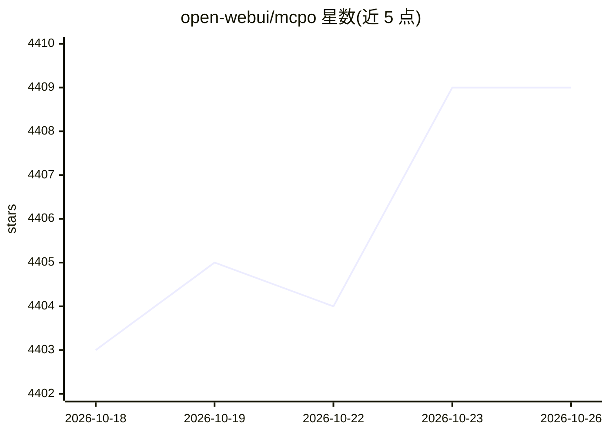

# open-webui/mcpo

⭐ 4,409 · Python · MIT · 推送 2026-05-17 · [GitHub](https://github.com/open-webui/mcpo) · [官网](https://docs.openwebui.com/features/plugin/tools/openapi-servers/mcp) · 组织维护

**把 MCP 工具代理为 OpenAPI 兼容 HTTP 服务的代理服务器**

接收一个 MCP 服务器命令（stdio/SSE/streamable-http），将其工具暴露为 RESTful OpenAPI 兼容的 HTTP 端点，并为每个工具自动生成交互式文档。面向需要让 LLM 代理与应用调用 MCP 工具的开发者。支持 API key、OAuth 2.1 动态客户端注册、多服务器配置文件与热重载、子路径部署。要求 Python 3.8+，可通过 uvx、pip 或 Docker 运行。

## 筛选速览

| 维度 | 判定 | 备注 |
|---|---|---|
| AI 角色 | `ai-ecosystem` | LLM/agent 周边工具 |
| 许可风险 | `permissive` | MIT |
| 部署形态 | `self-host` | docker 或自建部署 |
| 模型依赖 | — | README 未给出锁定关系 |
| 硬件要求 | — | 无带数字的原话,不猜 |
| 安装摩擦 | `low` | 无编译、无系统依赖或容器化 |
| 成熟度 | — | 结构信号不足 |

## 能力要点

- 将任意 MCP 服务器命令暴露为 OpenAPI 兼容 HTTP 服务
- 每个工具自动生成专属 OpenAPI schema 与交互文档
- OAuth 2.1 认证（默认动态客户端注册）与 API key 鉴权
- 单一配置文件服务多个 MCP 工具，支持热重载

## 适用场景

- 让只支持 OpenAPI 工具的 LLM 代理/应用调用 MCP 工具
- 为 stdio MCP 服务器加上 HTTP 鉴权层后对外提供
- 用一份配置文件统一代理多个 MCP 服务器

## 场景标签

`Agent 框架` · 领域:Agent 开发

## 证据(README 行号)

> L3: Expose any MCP tool as an OpenAPI-compatible HTTP server—instantly.
> L5: mcpo is a dead-simple proxy that takes an MCP server command and makes it accessible via standard RESTful OpenAPI, s

## 星数曲线

2026-10-18 4,403 → 2026-10-26 4,409（+6）

---
*卡片 v1 · prompt 1.4 · 生成 2026-10-20 · 置信度 high · 依据 README sha `d6ab415db2c1` · [字段定义](../../DATASET.md)*
