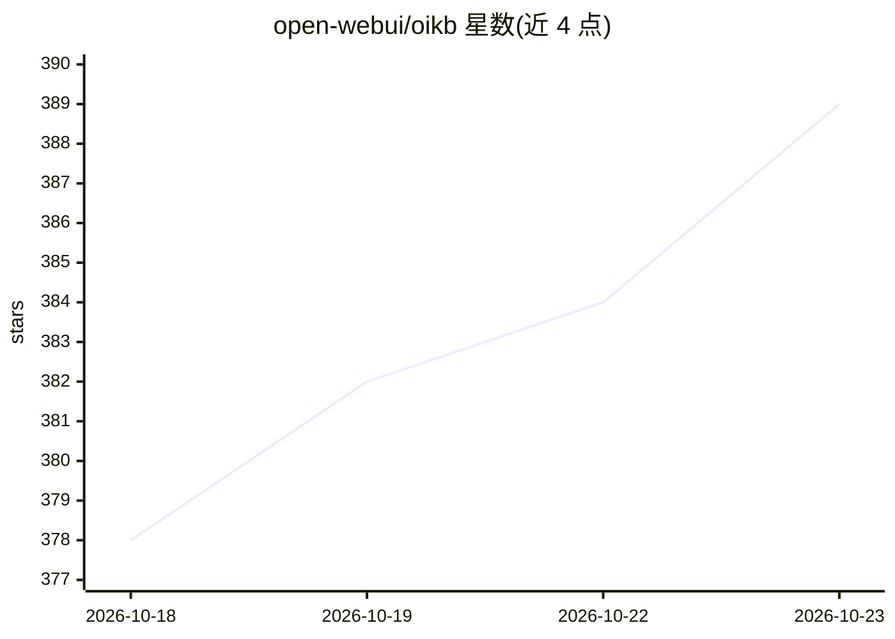

# open-webui/oikb

⭐ 389 · Python · MIT · 推送 2026-10-21 · [GitHub](https://github.com/open-webui/oikb) · 组织维护

**同步 47 类外部源内容到 Open WebUI 知识库的 CLI 工具**

面向 Open WebUI（需 0.9.6+）用户的知识库同步工具：以 pip 安装的 CLI，从本地目录、GitHub/Gitea 仓库、Confluence、S3、Zotero 等 47 种来源读取文件，通过源校验和增量比对，仅上传新增和修改的文件。支持交互式生成 .oikb.yaml 配置、watch 监听、定时守护进程（含 HTTP API、Webhook、Prometheus 指标）、include/exclude 过滤与同步历史。Docker 与 GitHub Actions 部署均有给出，MIT 许可。

## 筛选速览

| 维度 | 判定 | 备注 |
|---|---|---|
| AI 角色 | `ai-ecosystem` | LLM/agent 周边工具 |
| 许可风险 | `permissive` | MIT |
| 部署形态 | `self-host` | docker 或自建部署 |
| 模型依赖 | — | README 未给出锁定关系 |
| 硬件要求 | — | 无带数字的原话,不猜 |
| 安装摩擦 | `low` | 无编译、无系统依赖或容器化 |
| 成熟度 | — | 结构信号不足 |

## 能力要点

- 47 种连接器（代码仓库、云存储、Wiki、工单、IM、CRM 等）
- 基于校验和的增量同步，仅上传新增/修改文件
- 守护进程模式：定时/Cron 调度、Webhook 触发、Prometheus 指标与失败通知
- 可作为 Open WebUI 的 OpenAPI Tool Server，由 LLM 触发同步与查询历史

## 适用场景

- 把 GitHub 仓库或 Confluence 文档持续同步进 Open WebUI 知识库
- 定时或通过 Webhook 自动更新 RAG 知识库内容
- 把 Zotero 文献库整理同步为可检索的知识库

## 场景标签

`知识库管理` · 领域:知识与检索

## 证据(README 行号)

> L3: Keep your Open WebUI Knowledge Bases in sync. Point it at a local directory, a GitHub or Gitea repo, a Confluence sp
> L212: 1. Scan source, compute checksums
> L214: 3. Delete stale files, create missing directories

## 星数曲线

2026-10-18 378 → 2026-10-23 389（+11）

---
*卡片 v1 · prompt 1.4 · 生成 2026-10-21 · 置信度 high · 依据 README sha `1c00d022bac6` · [字段定义](../../DATASET.md)*
