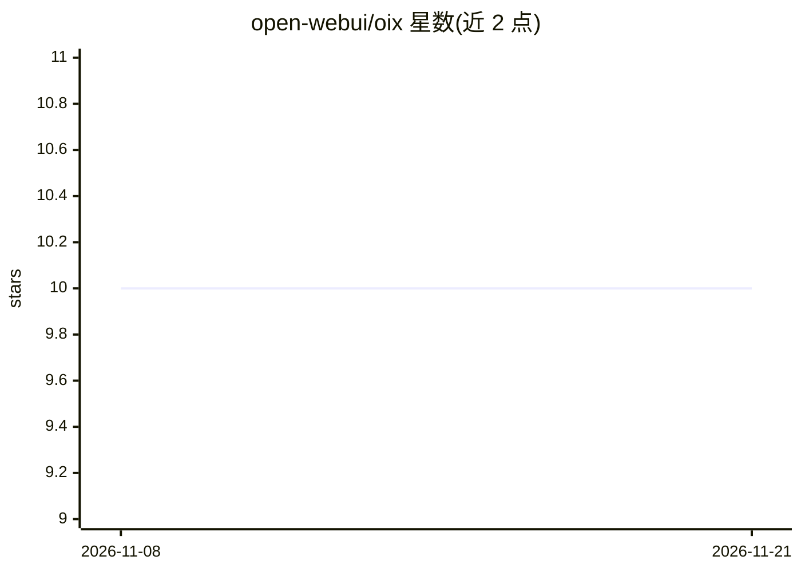

# open-webui/oix

⭐ 10 · Python · MIT · 推送 2026-10-13 · [GitHub](https://github.com/open-webui/oix) · 组织维护

**为 Open WebUI 构建应用的 Python SDK**

面向 Open WebUI Apps 体系的 Python SDK，提供带鉴权的事件机制与安装绑定的客户端。开发者以 App 形式编写异步事件处理器（提及、消息创建/更新/删除、消息按钮），SDK 在本地监听 WebSocket 端点，由 WebUI 建立出站连接，通过 API key 与签名密钥完成双向验证。支持多副本时用 Redis 路由 socket，事件投递为尽力而为、不保证重放，持久化工作需开发者自建任务存储。

## 筛选速览

| 维度 | 判定 | 备注 |
|---|---|---|
| AI 角色 | `ai-ecosystem` | LLM/agent 周边工具 |
| 许可风险 | `permissive` | MIT |
| 部署形态 | `library` | 以包/库形式分发 |
| 模型依赖 | — | README 未给出锁定关系 |
| 硬件要求 | — | 无带数字的原话,不猜 |
| 安装摩擦 | `low` | 无编译、无系统依赖或容器化 |
| 成熟度 | — | 结构信号不足 |

## 能力要点

- 带签名的鉴权连接：WebUI 固定应用公钥并验证连接证明
- 事件处理器支持 mention、消息事件与 channel.action 按钮
- 多副本部署经 Redis 共享 socket 路由，路由失败时关闭
- 运行时客户端可在同一 socket 上执行 API 调用（如 create_message）

## 适用场景

- 为 Open WebUI 频道编写自动回复或消息处理应用
- 在频道中通过消息按钮触发后台业务流程
- 将业务系统集成进 WebUI 的频道消息流

## 场景标签

 · 领域:LLM 生态/应用开发工具

## 证据(README 行号)

> L1: # oix: Open WebUI SDK
> L3: A Python SDK for building apps for Open WebUI, with authenticated events and an installation-bound client.
> L5: Requires Python 3.11+ and Open WebUI with Apps support.

## 星数曲线

2026-11-08 10 → 2026-11-21 10（+0）

---
*卡片 v1 · prompt 1.4 · 生成 2026-11-19 · 置信度 high · 依据 README sha `23f723f9aadf` · [字段定义](../../DATASET.md)*
