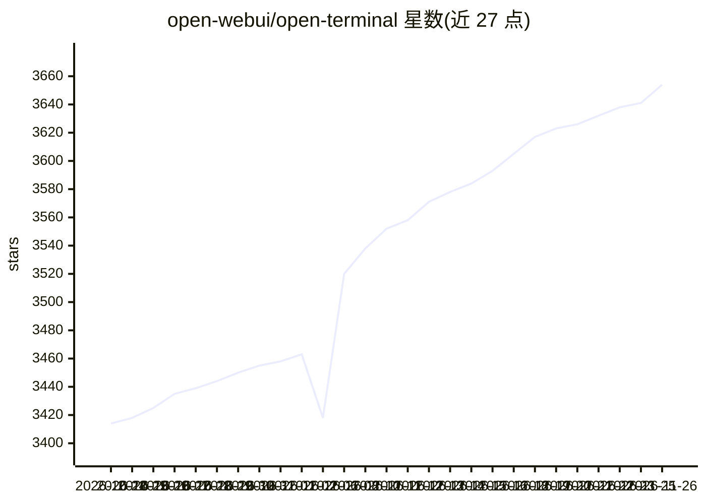

# open-webui/open-terminal

⭐ 3,654 · Python · MIT · 推送 2026-11-25 · [GitHub](https://github.com/open-webui/open-terminal) · [官网](https://openterminal.sh/) · 组织维护

**给 AI agent 提供自托管命令/文件/代码/浏览器执行环境的 REST API 服务器**

以自托管 REST API 形式提供一台供 agent 使用的"计算机"：运行命令、管理文件、执行代码、操作浏览器与桌面，可接入 Open WebUI 或自有工具。提供 Docker（latest/agents/cuda/slim/alpine/openshift 镜像变体）与 Python 3.11+ 两种部署方式，支持本地 IPC socket/named pipe、SSH bridge、多用户工作区。agents 镜像内置 Codex 与 Claude Code CLI，聊天中以 <agent>/<model> 形式发现 agent 模型，支持任意 ACP agent 免代码接入。生产多用户部署需 Open WebUI Enterprise License。

## 筛选速览

| 维度 | 判定 | 备注 |
|---|---|---|
| AI 角色 | `ai-ecosystem` | LLM/agent 周边工具 |
| 许可风险 | `permissive` | MIT |
| 部署形态 | `self-host` | docker 或自建部署 |
| 模型依赖 | locked-api |  |
| 硬件要求 | — | 无带数字的原话,不猜 |
| 安装摩擦 | `low` | 无编译、无系统依赖或容器化 |
| 成熟度 | — | 结构信号不足 |

## 能力要点

- 通过 REST API 提供命令执行、文件管理、代码执行、浏览器与桌面操作
- agents 镜像内置 Codex 与 Claude Code CLI，支持用自有账号登录使用
- 支持 15+ 编码 agent 及任意 ACP agent 的免代码接入（环境变量配置）
- 支持本地 IPC socket/named pipe、SSH bridge 与多用户工作区

## 适用场景

- 为 Open WebUI 聊天中的编码 agent 提供可执行命令的终端环境
- 自托管一个供自动化 agent 调用的沙箱式 REST API 执行环境
- 在隔离容器中运行 Codex/Claude Code 等编码 agent
- 跨机器通过 SSH 访问远程 agent 执行环境

## 场景标签

`编码 Agent` · 领域:编码与开发

## 证据(README 行号)

> L3: **A computer for your AI agents.** Run commands, search and manage files, execute code, and work with browsers and d
> L87: ## Connect to Open WebUI
> L99: Install and sign in to the agent CLIs as the user running Open Terminal. In a compatible Open WebUI checkout, selec

## 星数曲线

2026-10-24 3,414 → 2026-11-26 3,654（+240）

---
*卡片 v1 · prompt 1.4 · 生成 2026-11-23 · 置信度 high · 依据 README sha `834d1447cd31` · [字段定义](../../DATASET.md)*
