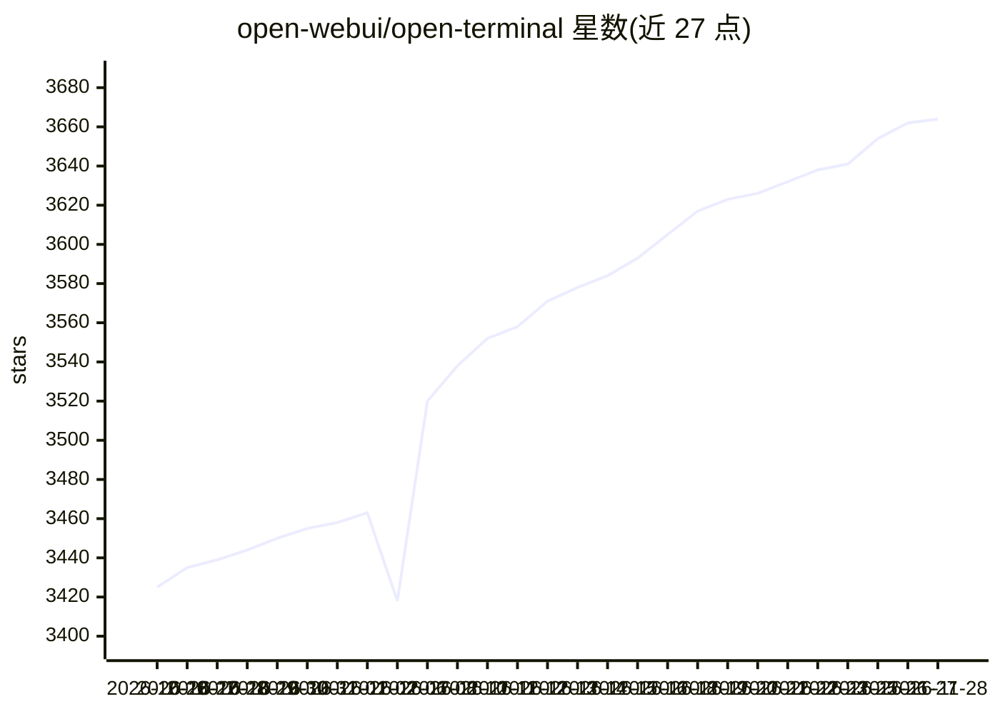

# open-webui/open-terminal

⭐ 3,664 · Python · MIT · 推送 2026-11-26 · [GitHub](https://github.com/open-webui/open-terminal) · [官网](https://openterminal.sh/) · 组织维护

**给 AI agent 提供远程命令/文件/浏览器执行环境的自托管 REST API**

自托管的服务，通过 REST API 暴露命令执行、文件搜索与管理、代码执行以及浏览器和桌面操作能力，供 AI agent 或自有工具调用。提供 Docker 镜像（latest/agents/cuda/slim/alpine/openshift 多种变体）与 pip/uv 两种 Python 安装方式，支持 API key 认证、本地 IPC socket/named pipe 访问、SSH bridge 转发。可接入 Open WebUI 集成界面，并支持发现和接入 Codex、Claude Code 等 13 种 ACP 编码 agent CLI。内置多用户模式不隔离用户，生产用途需 Open WebUI Enterprise License。

## 筛选速览

| 维度 | 判定 | 备注 |
|---|---|---|
| AI 角色 | `ai-ecosystem` | LLM/agent 周边工具 |
| 许可风险 | `permissive` | MIT |
| 部署形态 | `self-host` | docker 或自建部署 |
| 模型依赖 | locked-api |  |
| 硬件要求 | — | 无带数字的原话,不猜 |
| 安装摩擦 | `low` | 无编译、无系统依赖或容器化 |
| 成熟度 | — | 结构信号不足 |

## 能力要点

- 自托管 REST API：命令执行、文件管理、代码执行、浏览器与桌面操作
- 多种 Docker 镜像变体（含 CUDA/GPU PyTorch 与预装 Codex/Claude Code CLI 的 agents 版）
- 支持 13 种编码 agent CLI 的发现与接入（ACP 协议，可免代码扩展）
- 本地 IPC（Unix socket/named pipe）与 SSH bridge，无需开放 TCP 端口

## 适用场景

- 为自建 AI agent 提供可隔离的命令与文件执行环境
- 在 Open WebUI 聊天中调用终端、文件浏览器与编码 agent
- 通过 API 让 agent 操作浏览器页面与桌面环境

## 场景标签

`浏览器自动化` · 领域:效率与自动化

## 证据(README 行号)

> L3: **A computer for your AI agents.** Run commands, search and manage files, execute code, and work with browsers and d
> L99: Install and sign in to the agent CLIs as the user running Open Terminal. In a compatible Open WebUI checkout, selec
> L87: ## Connect to Open WebUI

## 星数曲线

2026-10-26 3,425 → 2026-11-28 3,664（+239）

---
*卡片 v1 · prompt 1.4 · 生成 2026-11-27 · 置信度 high · 依据 README sha `5d2b5b360888` · [字段定义](../../DATASET.md)*
