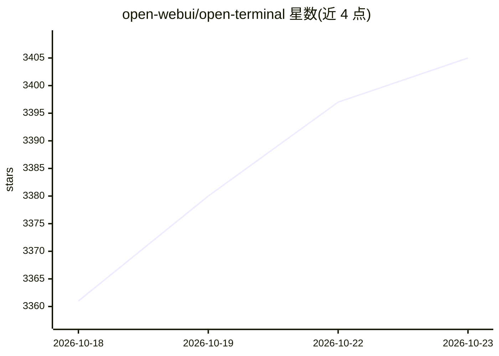

# open-webui/open-terminal

⭐ 3,405 · Python · MIT · 推送 2026-10-18 · [GitHub](https://github.com/open-webui/open-terminal) · [官网](https://openterminal.sh/) · 组织维护

**给 AI agent 提供的远程终端/代码执行环境（REST API）**

自托管的轻量终端服务：通过 REST API 向 AI 助手和自动化工具提供命令执行、文件管理、搜索与代码运行能力。提供 Docker 隔离沙箱（内置 Python/Node.js/git/ffmpeg/LibreOffice 等工具链）与 pip 安装的裸机模式（命令直接运行于宿主机）两种运行方式；提供 4 种镜像变体（latest/slim/alpine/openshift），支持环境变量运行时装包、挂载 Docker socket、外部工作区存储与多用户模式。与 Open WebUI 有集成通道（文件导航侧边栏）。注意：多用户模式不构成安全边界，README 明示不建议生产多用户部署。

## 筛选速览

| 维度 | 判定 | 备注 |
|---|---|---|
| AI 角色 | `ai-ecosystem` | LLM/agent 周边工具 |
| 许可风险 | `permissive` | MIT |
| 部署形态 | `self-host` | docker 或自建部署 |
| 模型依赖 | — | README 未给出锁定关系 |
| 硬件要求 | — | 无带数字的原话,不猜 |
| 安装摩擦 | `low` | 无编译、无系统依赖或容器化 |
| 成熟度 | — | 结构信号不足 |

## 能力要点

- REST API 提供命令执行、文件管理与代码运行
- Docker 沙箱与 pip 裸机两种部署方式
- 4 种镜像变体，latest 约 4GB 含完整工具链、alpine 约 230MB
- 多用户模式为每用户分配独立 Linux 账户与工作区（非安全隔离）

## 适用场景

- 为 AI 助手提供沙箱化的命令执行与文件操作环境
- 在 Open WebUI 中让 AI 直接操作终端与项目文件
- 为自动化脚本提供可通过 curl 调用的远程执行环境

## 场景标签

 · 领域:AI 基础设施/开发者工具

## 证据(README 行号)

> L3: A lightweight, self-hosted terminal that gives AI agents and automation tools a dedicated environment to run command
> L7: AI assistants are great at writing code, but they need somewhere to *run* it. Open Terminal is that place — a remote
> L197: Open Terminal integrates with Open WebUI, giving your AI assistants the ability to run commands, manage files, and

## 星数曲线

2026-10-18 3,361 → 2026-10-23 3,405（+44）

---
*卡片 v1 · prompt 1.4 · 生成 2026-10-20 · 置信度 high · 依据 README sha `8f188d510edd` · [字段定义](../../DATASET.md)*
