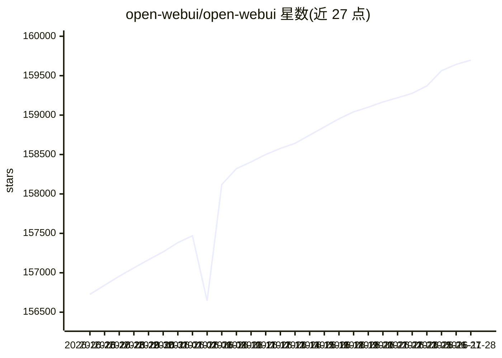

# open-webui/open-webui

⭐ 159,697 · Svelte · NOASSERTION · 推送 2026-11-27 · [GitHub](https://github.com/open-webui/open-webui) · [官网](https://openwebui.com) · 组织维护 · 中文 README

**自托管的多模型 AI 对话界面，支持本地与云端模型**

Open WebUI 是一个可自托管、可完全离线运行的 AI 交互平台：通过 Ollama 接入本地模型，通过 OpenAI 兼容 API 接入本地与云端模型，并可通过 Agent Client Protocol 添加 agent。安装方式包括 pip/uvx（Python 3.12）、Docker（提供 :main/:slim/:cuda/:ollama 等镜像标签）以及 macOS/Windows/Linux 桌面应用。README 另介绍生态组件（Terminal、知识库同步等），并说明许可证要求保留 Open WebUI 品牌。

## 筛选速览

| 维度 | 判定 | 备注 |
|---|---|---|
| AI 角色 | `ai-native` | 本体是模型或模型工具 |
| 许可风险 | `none` | NOASSERTION |
| 部署形态 | `self-host` | docker 或自建部署 |
| 模型依赖 | local-ok | 支持本地模型 |
| 硬件要求 | — | 无带数字的原话,不猜 |
| 安装摩擦 | `low` | 无编译、无系统依赖或容器化 |
| 成熟度 | — | 结构信号不足 |

## 动量与使用信号

- 维护:`active` — 距上次 push 1.7 天,年发版 44,388 位贡献者
- 涨星:近 1 天 **+100**(自 20261016 起算)
- 安装:pypi 包 `open-webui` 月下载 1,302,921
- 平台:WEB · 协议:OPENAI-API / MCP / OLLAMA

## 能力要点

- 通过 Ollama 运行本地模型，通过 OpenAI 兼容 API 接入本地与云端模型
- 支持完全离线运行（HF_HUB_OFFLINE 环境变量）
- 提供 :cuda 加速镜像与 :ollama 捆绑镜像
- 支持 pip/Docker/桌面应用多种安装方式

## 适用场景

- 在内网或本地离线环境部署 AI 对话界面
- 通过一个界面统一访问本地模型和云端 API 模型
- 接入 ACP agent 进行对话交互

## 场景标签

`聊天机器人` `RAG` · 领域:对话与助手

## 证据(README 行号)

> L3:  Open WebUI is a home for AI : an extensible, easy-to-use, self-hosted platform built to run entirely offline. Conne
> L41: ### Installation

## 星数曲线

2026-10-26 156,726 → 2026-11-28 159,697（+2,971）

---
*卡片 v1 · prompt 1.4 · 生成 2026-11-26 · 置信度 high · 依据 README sha `b48564d5c673` · [字段定义](../../DATASET.md)*
