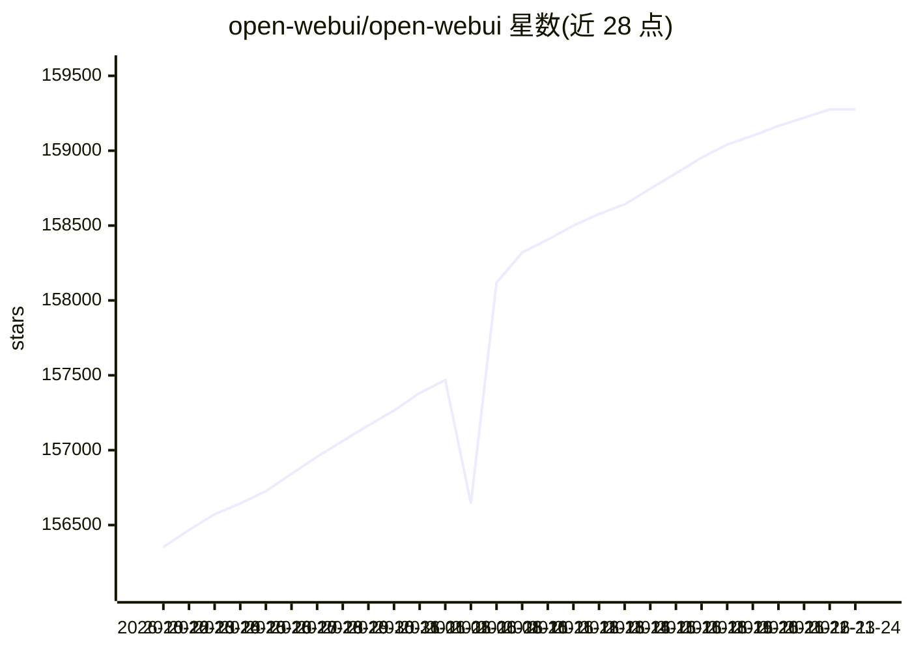

# open-webui/open-webui

⭐ 159,276 · Svelte · NOASSERTION · 推送 2026-11-22 · [GitHub](https://github.com/open-webui/open-webui) · [官网](https://openwebui.com) · 组织维护

**自托管 AI 聊天界面：连接 Ollama 与 OpenAI 兼容 API**

Open WebUI 是一个可扩展、可完全离线运行的自托管 AI 平台界面：通过 Ollama 连接本地模型，或通过 OpenAI 兼容 API 使用本地与云端模型。提供 Python（uvx/pip）、Docker 及桌面应用三种安装方式，Docker 镜像含标准、slim、CUDA 加速与捆绑 Ollama 等变体；主题标签显示包含 RAG 与 MCP 能力。许可证要求保留 Open WebUI 品牌标识。

## 筛选速览

| 维度 | 判定 | 备注 |
|---|---|---|
| AI 角色 | `ai-ecosystem` | LLM/agent 周边工具 |
| 许可风险 | `none` | NOASSERTION |
| 部署形态 | `self-host` | docker 或自建部署 |
| 模型依赖 | local-ok | 支持本地模型 |
| 硬件要求 | — | 无带数字的原话,不猜 |
| 安装摩擦 | `low` | 无编译、无系统依赖或容器化 |
| 成熟度 | — | 结构信号不足 |

## 动量与使用信号

- 维护:`active` — 距上次 push 1.7 天,年发版 44,388 位贡献者
- 涨星:近 1 天 **+100**(自 20261016 起算)
- 安装:pypi 包 `open-webui` 月下载 1,302,921
- 平台:WEB · 协议:OPENAI-API / MCP / OLLAMA

## 能力要点

- 支持通过 Ollama 接入本地模型与 OpenAI 兼容 API 接入云端模型
- 完全离线运行的自托管平台
- 提供 macOS/Windows/Linux 原生桌面应用
- Docker 镜像含 CUDA 加速与捆绑 Ollama 变体

## 适用场景

- 在本地离线运行并与本地大模型对话
- 用统一界面管理本地与云端多个模型服务
- 在企业内部署带工作区编排的 AI 入口

## 场景标签

`聊天机器人` `RAG` · 领域:对话与助手

## 证据(README 行号)

> L3:  Open WebUI is a home for AI : an extensible, easy-to-use, self-hosted platform built to run entirely offline. Conne
> L41: ### Installation

## 星数曲线

2026-10-22 156,353 → 2026-11-24 159,276（+2,923）

---
*卡片 v1 · prompt 1.4 · 生成 2026-11-22 · 置信度 high · 依据 README sha `04839d5ac964` · [字段定义](../../DATASET.md)*
