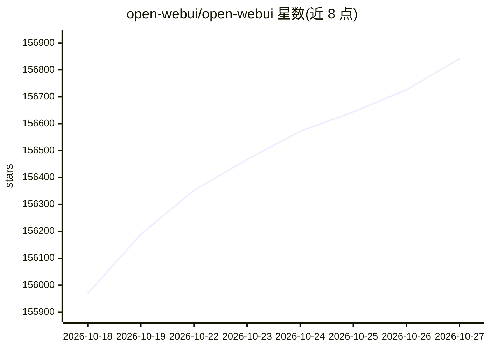

# open-webui/open-webui

⭐ 156,842 · Python · NOASSERTION · 推送 2026-10-26 · [GitHub](https://github.com/open-webui/open-webui) · [官网](https://openwebui.com) · 组织维护

**自托管 AI 交互界面，接入本地与云端多模型**

自托管 Web 平台，通过 Ollama 与 OpenAI 兼容 API 连接本地及云端模型，提供 RBAC 用户组、插件体系（Filters/Actions/Pipes/Tools/Skills）、MCP 与 OpenAPI 工具服务器接入、RAG（9 种向量数据库、混合检索）、网络搜索注入、图像生成、语音视频通话、日历与定时任务、企业认证（LDAP/SSO/SCIM）及 OpenTelemetry 可观测性。可通过 pip、Docker、Kubernetes 安装，支持纯 CPU 或 CUDA 镜像，另有 macOS/Windows/Linux 原生桌面应用。

## 筛选速览

| 维度 | 判定 | 备注 |
|---|---|---|
| AI 角色 | `ai-ecosystem` | LLM/agent 周边工具 |
| 许可风险 | `none` | NOASSERTION |
| 部署形态 | `self-host` | docker 或自建部署 |
| 模型依赖 | local-ok | 支持本地模型 |
| 硬件要求 | `cpu-ok` | |
| 安装摩擦 | `low` | 无编译、无系统依赖或容器化 |
| 成熟度 | — | 结构信号不足 |

## 动量与使用信号

- 维护:`active` — 距上次 push 1.7 天,年发版 44,388 位贡献者
- 涨星:近 1 天 **+100**(自 20261016 起算)
- 安装:pypi 包 `open-webui` 月下载 1,302,921
- 平台:WEB · 协议:OPENAI-API / MCP / OLLAMA

## 能力要点

- 支持 Ollama 与任何 OpenAI 兼容 API（LMStudio、GroqCloud、Mistral、OpenRouter、vLLM 等）
- 插件体系与 MCP/OpenAPI 工具服务器接入，可构建带终端与文件系统的 Agent
- RAG 支持 9 种向量数据库、BM25+向量混合检索与多家网络搜索提供商
- 企业功能：RBAC、LDAP/SSO/SCIM、多节点水平扩展、OpenTelemetry

## 适用场景

- 在本地或私有服务器上部署多模型对话界面
- 团队共享的 AI 工作台，带权限管理与用量统计
- 基于文档知识库的检索增强问答
- 给 Agent 配置工具与终端执行多步任务

## 场景标签

`聊天机器人` `RAG` · 领域:对话与助手

## 证据(README 行号)

> L12: Open WebUI is **a home for AI**, a self-hosted AI platform that's **extensible**, **feature-rich**, user-friendly, 
> L31: - 🧩 **Plugin Support**: Extend Open WebUI with **Filters**, **Actions**, **Pipes**, **Tools**, and **Skills**. Conn
> L57: - 📚 **Local RAG Integration**: Retrieval Augmented Generation backed by 9 vector databases and multiple content-ext

## 星数曲线

2026-10-18 155,970 → 2026-10-27 156,842（+872）

---
*卡片 v1 · prompt 1.4 · 生成 2026-10-18 · 置信度 high · 依据 README sha `346c3774f88b` · [字段定义](../../DATASET.md)*
