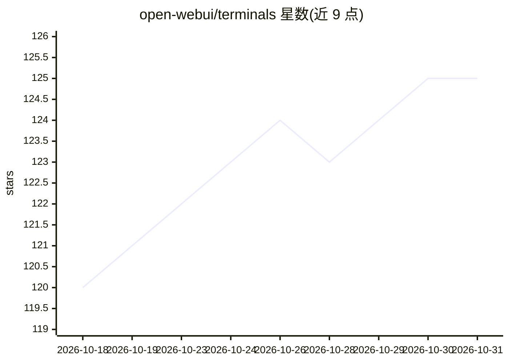

# open-webui/terminals

⭐ 125 · Python · NOASSERTION · 推送 2026-10-16 · [GitHub](https://github.com/open-webui/terminals) · [官网](https://docs.openwebui.com/ecosystem/open-terminal) · 组织维护

**为 Open WebUI 用户编排隔离终端容器的服务层**

Terminals 是 Open WebUI 的终端容器编排服务：为每个用户自动创建隔离的 Open Terminal 容器，代理流量、执行资源限额（CPU/内存/存储）与网络规则，并在空闲或策略触发时清理。支持 Docker、Kubernetes 直连与 Kubernetes Operator（CRD）三种后端；通过 REST API 定义策略（镜像、环境变量、限额、存储模式、定时重置），并支持 Open WebUI JWT 校验模式。注意：生产环境需要 Open WebUI 企业许可。

## 筛选速览

| 维度 | 判定 | 备注 |
|---|---|---|
| AI 角色 | `ai-ecosystem` | LLM/agent 周边工具 |
| 许可风险 | `none` | NOASSERTION |
| 部署形态 | `self-host` | docker 或自建部署 |
| 模型依赖 | — | README 未给出锁定关系 |
| 硬件要求 | — | 无带数字的原话,不猜 |
| 安装摩擦 | `low` | 无编译、无系统依赖或容器化 |
| 成熟度 | — | 结构信号不足 |

## 能力要点

- 每用户独立容器的全生命周期自动管理（创建/代理/限额/清理）
- Docker、Kubernetes、Kubernetes Operator 三种后端
- 策略 API 定义镜像、资源限额、存储模式与 cron 定时重置
- Open WebUI JWT 集成与内置最小管理 UI

## 适用场景

- 为 Open WebUI 的每个用户提供隔离的代码执行终端
- 按策略为不同团队分配不同资源限额与镜像的终端环境
- 在企业集群上做终端工作区的定期重置与留存管理

## 场景标签

 · 领域:基础设施/容器编排

## 证据(README 行号)

> L5: Terminals gives every Open WebUI user their own isolated container, with separate credentials, resource limits, and 
> L13: > **Production use requires an Open WebUI Enterprise License with Terminals access.** Contact the Open WebUI team t

## 星数曲线

2026-10-18 120 → 2026-10-31 125（+5）

---
*卡片 v1 · prompt 1.4 · 生成 2026-10-23 · 置信度 high · 依据 README sha `2dcedc807460` · [字段定义](../../DATASET.md)*
