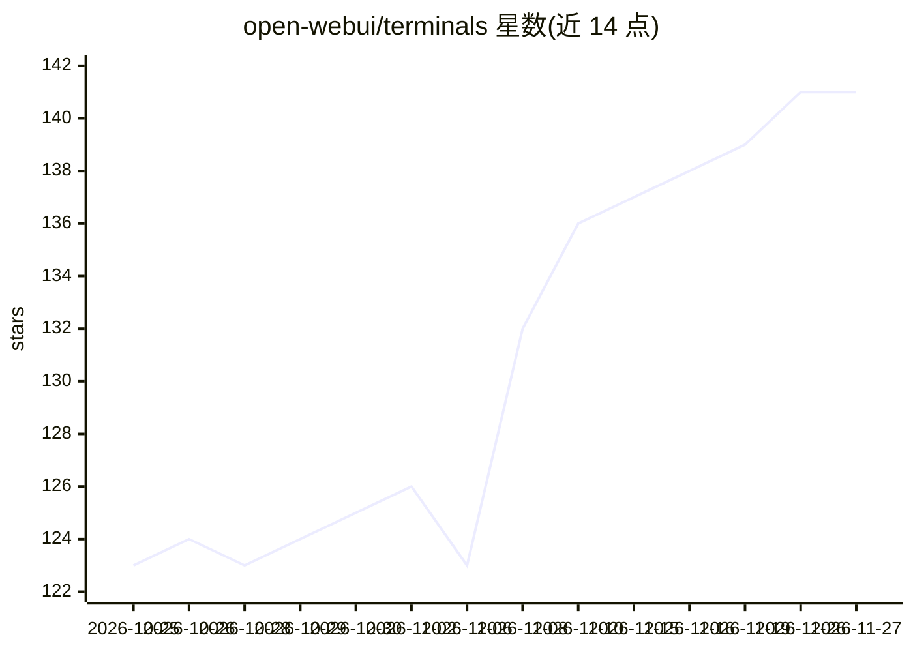

# open-webui/terminals

⭐ 141 · Python · NOASSERTION · 推送 2026-11-26 · [GitHub](https://github.com/open-webui/terminals) · [官网](https://docs.openwebui.com/ecosystem/open-terminal) · 组织维护

**Open WebUI 的机器编排层：按模板按需运行终端容器**

Machines API (Terminals) 是面向 Open WebUI（0.13.4+）的机器编排服务：按模板在 Docker 或 Kubernetes 上按需启动 Machine (Open Terminal) 容器，按模板与作用域路由请求，并管理持久化文件与空闲清理。支持 null/user/chat/model 四种环境作用域、CPU/内存/存储限制、空闲超时与生命周期策略、定时文件重置、网络配置文件（docker_network/kubernetes_labels），以及内置管理 UI 与 REST API。商业或组织生产使用需 Open WebUI Enterprise License。

## 筛选速览

| 维度 | 判定 | 备注 |
|---|---|---|
| AI 角色 | `ai-ecosystem` | LLM/agent 周边工具 |
| 许可风险 | `none` | NOASSERTION |
| 部署形态 | `self-host` | docker 或自建部署 |
| 模型依赖 | — | README 未给出锁定关系 |
| 硬件要求 | — | 无带数字的原话,不猜 |
| 安装摩擦 | `low` | 无编译、无系统依赖或容器化 |
| 成熟度 | — | 结构信号不足 |

## 能力要点

- 按模板按需启动容器，支持 null/user/chat/model 四种作用域隔离环境
- 持久化用户工作区，支持停止保留、定时重置与最大生命周期管理
- Docker 与 Kubernetes（含 operator/受限模式）双后端编排
- 内置管理 UI 与 REST API，支持 CPU/内存/存储/镜像白名单限制

## 适用场景

- 为 Open WebUI 的机器菜单提供按模板创建的终端运行环境
- 按用户或会话隔离的代码执行工作区，带资源与生命周期限制
- 在 Kubernetes 上集中管理多用户终端容器的存储与网络策略

## 场景标签

 · 领域:LLM 应用基础设施/运行环境编排

## 证据(README 行号)

> L3: Run Machine (Open Terminal) environments from shared templates. The service starts containers on demand, routes requ
> L5: **Requires Open WebUI 0.13.4 or later.**
> L12: > Commercial or organizational production use requires an Open WebUI Enterprise License with Terminals access.

## 星数曲线

2026-10-25 123 → 2026-11-27 141（+18）

---
*卡片 v1 · prompt 1.4 · 生成 2026-11-27 · 置信度 high · 依据 README sha `67a1b4a5e433` · [字段定义](../../DATASET.md)*
