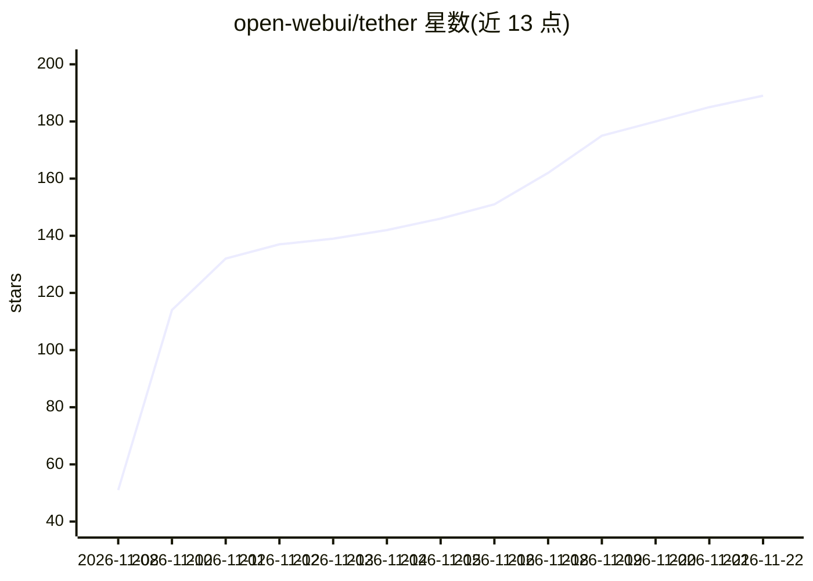

# open-webui/tether

⭐ 189 · TypeScript · NOASSERTION · 推送 2026-11-19 · [GitHub](https://github.com/open-webui/tether) · [官网](https://docs.openwebui.com/ecosystem/tether) · 组织维护

**Open WebUI 的桌面伴侣应用，从桌面直连你的 AI**

Tether 是 Open WebUI 的桌面客户端，将浏览器中的 Open WebUI 体验扩展到桌面：用户可在桌面直接与自己的 AI 交互，并授予其在本机操作的能力。支持连接本地 stdio 与 Streamable HTTP 的 MCP 服务器；macOS 与部分 Windows 设备上可将 Open Terminal 限制到指定文件夹的沙箱（Linux 不支持沙箱）。提供 macOS/Windows/Linux 的多架构安装包，Snap 与 Flatpak 包在 releases 页面。许可为个人非商业免费，商用需 Open WebUI 企业许可。

## 筛选速览

| 维度 | 判定 | 备注 |
|---|---|---|
| AI 角色 | `ai-ecosystem` | LLM/agent 周边工具 |
| 许可风险 | `none` | NOASSERTION |
| 部署形态 | `desktop` | 安装包/桌面程序 |
| 模型依赖 | — | README 未给出锁定关系 |
| 硬件要求 | — | 无带数字的原话,不猜 |
| 安装摩擦 | `low` | 无编译、无系统依赖或容器化 |
| 成熟度 | — | 结构信号不足 |

## 能力要点

- 将 Open WebUI 扩展为桌面应用
- 支持连接 stdio 与 Streamable HTTP MCP 服务器
- Open Terminal 可沙箱到本地文件夹（macOS/部分 Windows）
- 覆盖 macOS/Windows/Linux 多架构桌面安装包

## 适用场景

- 不想打开浏览器、在桌面直接使用 Open WebUI
- 让 AI 通过 MCP 集成本地工具
- 在受限文件夹范围内让 AI 执行终端操作

## 场景标签

`聊天机器人` `AI 助手` · 领域:对话与助手

## 证据(README 行号)

> L3: Tether
> L7: Tether extends Open WebUI beyond the browser. Interact with your AI right from your desktop, and give it the access 

## 星数曲线

2026-11-08 51 → 2026-11-22 189（+138）

---
*卡片 v1 · prompt 1.4 · 生成 2026-11-17 · 置信度 high · 依据 README sha `3d90d80e48a2` · [字段定义](../../DATASET.md)*
