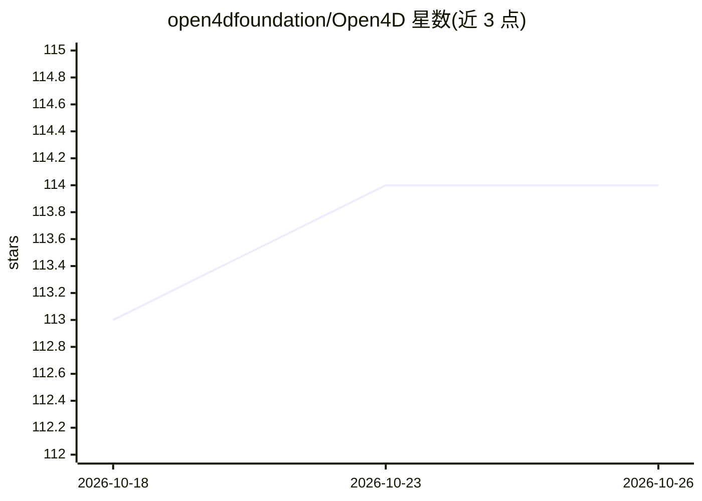

# open4dfoundation/Open4D

⭐ 114 · C++ · MIT · 推送 2026-10-23 · [GitHub](https://github.com/open4dfoundation/Open4D) · [官网](https://open4dfoundation.github.io/) · 组织维护

**4D 动态几何的编解码、重建与流式传输 Python 库**

面向时变 3D 网格序列与 Gaussian splat 数据的研究型 Python 库：提供 12 种公开编解码器写入 .o4d 容器（含 V-DMC、N4MC、QNDF 等研究后端适配器，通过插件 entry point 按需加载）、RGB-D 深度图重建、TCP 流式传输（raw/zlib/zstd/quantized/draco 档位）与交互式查看器（网格、点云、UV 纹理、协方差绘制的 Gaussian splat）。MIT 核心仅依赖 NumPy，支持 Python 3.10–3.13；研究后端与模型权重单独安装且各有许可。给从事 4D 几何压缩与流媒体研究的开发者使用。

## 筛选速览

| 维度 | 判定 | 备注 |
|---|---|---|
| AI 角色 | `ai-ecosystem` | LLM/agent 周边工具 |
| 许可风险 | `permissive` | MIT |
| 部署形态 | `library` | 以包/库形式分发 |
| 模型依赖 | — | README 未给出锁定关系 |
| 硬件要求 | — | 无带数字的原话,不猜 |
| 安装摩擦 | `medium` | 含编译或系统依赖之一 |
| 成熟度 | — | 结构信号不足 |

## 能力要点

- 12 种公开编解码器统一写入 .o4d 容器，插件式后端按需加载
- RGB-D 深度图重建，支持多相机与相机位姿输入
- TCP 流式传输含 O4S2 压缩档位、丢帧后关键帧修复与吞吐统计
- 查看器支持网格、点云、UV 纹理与协方差加 SH 颜色的 Gaussian splat

## 适用场景

- 压缩与归档时变网格序列或 Gaussian splat 数据
- 从 RGB-D 相机采集重建动态几何
- 实时传输并可视化采集端的动态几何帧流

## 场景标签

 · 领域:三维几何处理/计算机视觉工具库

## 证据(README 行号)

> L3: A Python library for research codecs, reconstruction and streaming of 4D geometry.
> L31: Research adapters are separate installable packages. Their source backends,
> L32: native programs and model weights are not bundled in either package. From a

## 星数曲线

2026-10-18 113 → 2026-10-26 114（+1）

---
*卡片 v1 · prompt 1.4 · 生成 2026-10-23 · 置信度 low · 依据 README sha `57f1db31df60` · [字段定义](../../DATASET.md)*
