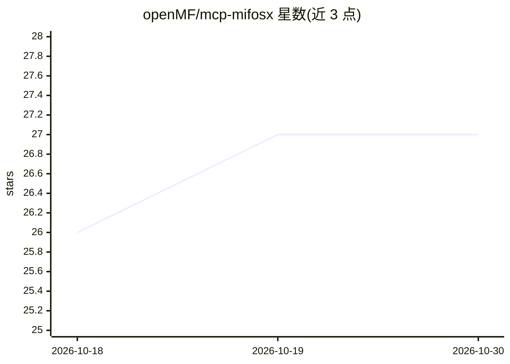

# openMF/mcp-mifosx

⭐ 27 · Java · MPL-2.0 · 推送 2026-10-29 · [GitHub](https://github.com/openMF/mcp-mifosx) · [官网](https://ai.mifos.community/) · 组织维护

**为 Mifos X 核心银行系统提供 MCP 工具服务器，供 AI agent 调用**

面向 Apache Fineract/Mifos X 银行后端的 Model Context Protocol 服务器集合，把客户、贷款、存款、记账等核心银行操作封装为类型化工具供 MCP 客户端调用。提供 Go（102 工具）、Rust（89 工具，含独占批量操作）、Python（49 工具）、Java/Quarkus（38 工具）四种实现，均基于同一 Fineract REST API、无状态设计，通过共享 Smoke Tests 保持行为一致。安全上依赖 Fineract 原生 RBAC，按调用者凭证鉴权，服务器自身不外呼、不存数据。

## 筛选速览

| 维度 | 判定 | 备注 |
|---|---|---|
| AI 角色 | `ai-ecosystem` | LLM/agent 周边工具 |
| 许可风险 | `permissive` | MPL-2.0 |
| 部署形态 | `library` | 以包/库形式分发 |
| 模型依赖 | — | README 未给出锁定关系 |
| 硬件要求 | — | 无带数字的原话,不猜 |
| 安装摩擦 | `high` | 编译与系统依赖俱全 |
| 成熟度 | — | 结构信号不足 |

## 能力要点

- Go/Rust/Python/Java 四种实现，分别提供 102/89/49/38 个类型化工具
- 无状态设计：不存储用户数据、PII 或 AI 记忆
- 工具调用使用调用职员凭证，由 Fineract 原生 RBAC 校验
- 支持 Stdio 与 SSE 两种传输模式（Go 实现）

## 适用场景

- 让 Claude/GPT-4/Qwen 等 MCP 客户端操作 Mifos X 银行数据
- 通过 AI 助手完成开户、贷款审批、存款取款等后台操作
- 为 Mifos Agentic Platform 的专业 agent 提供工具层

## 场景标签

 · 领域:金融科技/核心银行 AI 工具层

## 证据(README 行号)

> L3: This project provides Model Context Protocol (MCP) for the Mifos X Ecosystem, enabling AI agents to access financial
> L13: The Mifos MCP Server acts as a standalone, stateless integration tier that bridges any AI assistant or agent framew
> L22: This repository is **framework-agnostic**. The client (LLM brain, UI, memory) lives in a separate repository. Any M

## 星数曲线

2026-10-18 26 → 2026-10-30 27（+1）

---
*卡片 v1 · prompt 1.4 · 生成 2026-10-26 · 置信度 mid · 依据 README sha `689f096521d4` · [字段定义](../../DATASET.md)*
