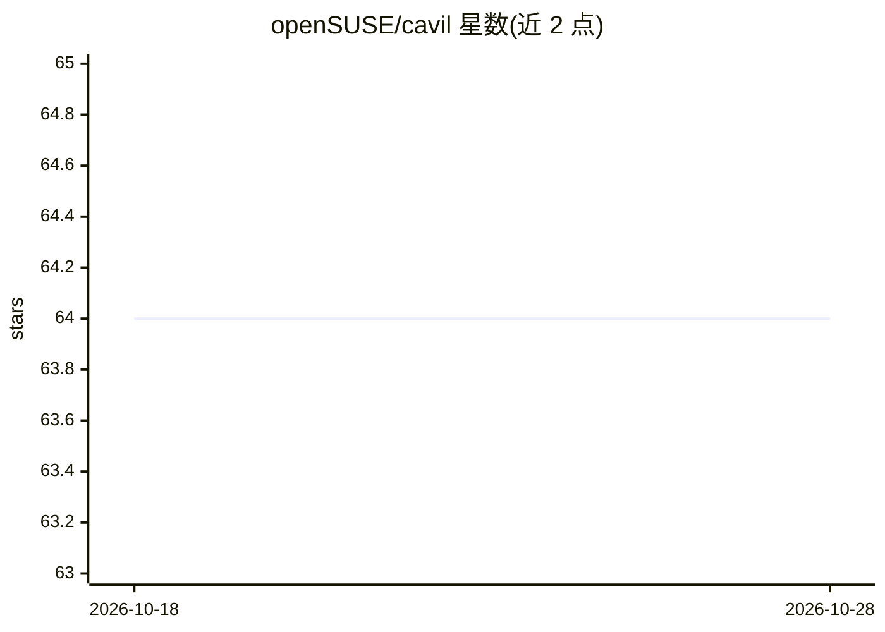

# openSUSE/cavil

⭐ 64 · Perl · GPL-2.0 · 推送 2026-10-27 · [GitHub](https://github.com/openSUSE/cavil) · 组织维护

**开源法律审查与 SBOM 系统，供 openSUSE/SUSE 打包合规使用**

Cavil 是被 openSUSE Tumbleweed/Leap 与 SUSE Linux Enterprise 开发使用的法律审查与 SBOM 系统：对 RPM、DEB、tarball 等包格式做源码许可扫描，基于 28,000 条律师人工审校的模式库识别 2000 种许可组合，生成 SPDX 3.0.1 格式 SBOM（面向 EU CRA 与 CISA 最低要素）。审查流程包含人工审批与基于机器学习文本分类器的扫描噪音自动消解，分类器模型由 openSUSE HuggingFace 组织提供（如 Cavil-Qwen3.5-4B，通常以 llama.cpp 服务器部署）。另提供 MCP、REST API 与 Open Build Service/Gitea 机器人集成。生成的报告不构成法律意见。

## 筛选速览

| 维度 | 判定 | 备注 |
|---|---|---|
| AI 角色 | `ai-enhanced` | 去掉 AI 部分产品仍成立 |
| 许可风险 | `viral` | GPL-2.0 |
| 部署形态 | `library` | 以包/库形式分发 |
| 模型依赖 | — | README 未给出锁定关系 |
| 硬件要求 | — | 无带数字的原话,不猜 |
| 安装摩擦 | `low` | 无编译、无系统依赖或容器化 |
| 成熟度 | — | 结构信号不足 |

## 能力要点

- 28,000 条人工审校模式、2000 种许可组合、500 种 SPDX 表达式识别
- SPDX 3.0.1 SBOM 生成，面向 EU CRA（BSI TR-03183-2）与 CISA 最低要素
- 机器学习分类器自动消解约 80% 误报的模式匹配噪音
- 检测 vendored/bundled 子组件（npm/Cargo/PyPI/Maven/Go 等 8 种生态）

## 适用场景

- 发行版打包流程中做源码许可审查与风险评级
- 生成满足 EU CRA 要求的 SPDX SBOM
- 供应链与漏洞分诊时按 purl 检索包与组件
- 通过 MCP 接入 AI 辅助法律审查工作流

## 场景标签

 · 领域:软件供应链/合规

## 证据(README 行号)

> L5: Cavil is a legal review and Software Bill of Materials (SBOM) system. It is used in the development of
> L36: * Machine learning text classification of snippets, which drives Cavil's automated resolution of scanner noise
> L50: Cavil relies on a machine learning model for text classification. The pattern matching that identifies clusters of

## 星数曲线

2026-10-18 64 → 2026-10-28 64（+0）

---
*卡片 v1 · prompt 1.4 · 生成 2026-10-24 · 置信度 mid · 依据 README sha `cc90a4cc6145` · [字段定义](../../DATASET.md)*
