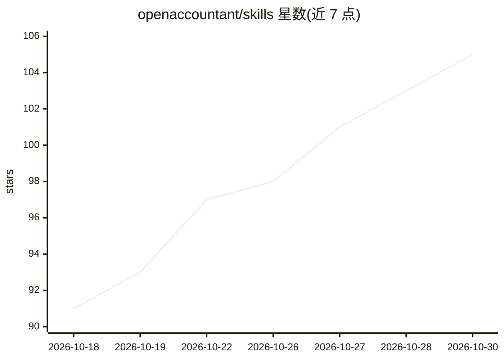

# openaccountant/skills

⭐ 105 · MIT · 推送 2026-04-09 · [GitHub](https://github.com/openaccountant/skills) · 组织维护

**44 个面向 AI agent 的开源财务技能集合（SKILL.md 格式）**

以 SKILL.md 格式发布的财务技能库，共 44 个技能，覆盖个人理财（债务偿还、净资产、预算）、企业与自由职业者（损益表、现金流预测、发票账龄）及税务（Schedule C 归类、季度税、折旧）三类场景。兼容 Claude Code、Cursor、Codex、Gemini CLI、Copilot 等十余种 agent，通过 npx skills add 安装到各平台配置目录。技能双模式运行：配合 Wilson CLI 直接查询数据库，或基于 CSV/表格的手动流程。另提及付费版 Open Accountant Pro。

## 筛选速览

| 维度 | 判定 | 备注 |
|---|---|---|
| AI 角色 | `ai-knowledge` | 知识聚合/清单类 |
| 许可风险 | `permissive` | MIT |
| 部署形态 | `library` | 以包/库形式分发 |
| 模型依赖 | — | README 未给出锁定关系 |
| 硬件要求 | — | 无带数字的原话,不猜 |
| 安装摩擦 | `low` | 无编译、无系统依赖或容器化 |
| 成熟度 | — | 结构信号不足 |

## 能力要点

- 44 个财务技能，按个人/企业/共享三类组织
- 兼容十余种支持 SKILL.md 的 agent 平台并列出各平台发现路径
- 双模式：Wilson CLI 直连数据查询或 CSV 手动流程
- npx skills add 支持整库或单个技能安装

## 适用场景

- 为 Claude Code / Cursor 等 agent 添加记账与报税能力
- 让 agent 生成损益表、现金流预测等财务报表
- 个人用户做债务偿还计划与订阅审计

## 场景标签

 · 领域:财务/会计工具

## 证据(README 行号)

> L3: Free, open-source financial skills for AI agents. Works with Wilson CLI, Claude Code, Cursor, OpenAI Codex, Gemini C
> L59: |Skill|Description|
> L118: Every skill works in two modes:

## 星数曲线

2026-10-18 91 → 2026-10-30 105（+14）

---
*卡片 v1 · prompt 1.4 · 生成 2026-10-23 · 置信度 high · 依据 README sha `4154a16df86e` · [字段定义](../../DATASET.md)*
