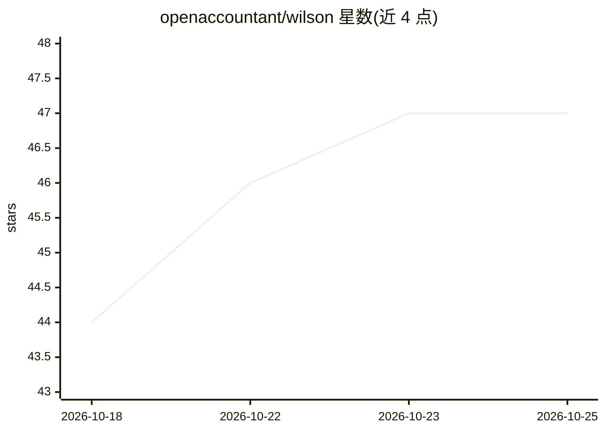

# openaccountant/wilson

⭐ 47 · TypeScript · MIT · 推送 2026-10-25 · [GitHub](https://github.com/openaccountant/wilson) · [官网](https://openaccountant.ai) · 组织维护

**本地优先的 AI 记账 CLI：导入账单、AI 分类、预算与报表**

面向终端用户的终端财务助手（Wilson / Open Accountant CLI）：导入银行 CSV（Chase/Amex/通用格式）或同步 Monarch Money 账户，用 LLM 将交易归入 18 个消费类别，检测重复扣款、异常支出与遗忘订阅，支持预算、储蓄目标、语义搜索（本地嵌入）与 Web 仪表盘，可导出 SFT/DPO 训练数据。支持 9 家 LLM 提供商含本地 Ollama；全部数据存本地 SQLite，浏览器镜像为明文存储。需 Bun v1.1+，从源码 git clone 安装运行。

## 筛选速览

| 维度 | 判定 | 备注 |
|---|---|---|
| AI 角色 | `ai-enhanced` | 去掉 AI 部分产品仍成立 |
| 许可风险 | `permissive` | MIT |
| 部署形态 | `None` |  |
| 模型依赖 | local-ok | 支持本地模型 |
| 硬件要求 | — | 无带数字的原话,不猜 |
| 安装摩擦 | `low` | 无编译、无系统依赖或容器化 |
| 成熟度 | — | 结构信号不足 |

## 能力要点

- AI 将交易分类到 18 个消费类别，9 家 LLM 提供商可选含本地 Ollama
- 重复扣款、异常峰值、遗忘订阅检测与多步技能工作流
- 本地嵌入的语义交易搜索（wilson --index），数据不出本机
- MCP 服务器扩展工具、可导出 SFT/DPO 训练数据

## 适用场景

- 导入银行 CSV 后用自然语言查询消费情况
- 设置类别预算与储蓄目标并跟踪月度进度
- 本地运行、不让财务数据离开本机的个人记账

## 场景标签

`语义搜索` · 领域:知识与检索

## 证据(README 行号)

> L13: Import bank statements, categorize transactions with AI, surface spending anomalies, and get actionable advice — al
> L73: - **AI categorization** — Classifies transactions into 18 spending categories using your choice of LLM

## 星数曲线

2026-10-18 44 → 2026-10-25 47（+3）

---
*卡片 v1 · prompt 1.4 · 生成 2026-10-25 · 置信度 high · 依据 README sha `662dba97a9d3` · [字段定义](../../DATASET.md)*
