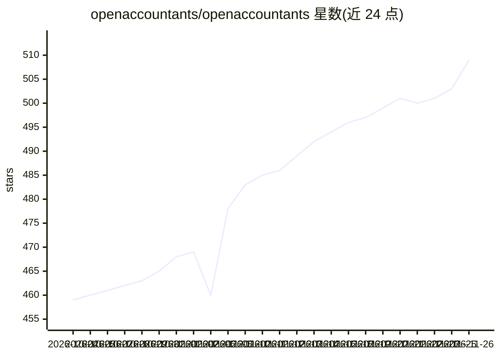

# openaccountants/openaccountants

⭐ 509 · HTML · AGPL-3.0 · 推送 2026-11-25 · [GitHub](https://github.com/openaccountants/openaccountants) · [官网](https://www.openaccountants.com/connect) · 组织维护

**面向 AI 的税务技能库：190+ 地区税率条款可溯源引用**

收录按各国官方法律与税务机关页面编写的 AI 税务技能，每个数字（税率、门槛、期限）链接到官方来源页；每次 PR 会检查数字是否出现在其来源页上，并保存来源页快照存档。技能经注册会计师逐条批准（当前 100+ 条有具名批准），批准状态通过 OpenAccountants MCP 插件展示。可通过 MCP 地址接入 Claude/ChatGPT/Cursor 等，或自托管 Python MCP 服务器、手动下载 packages/ 目录文件。声明为一般参考而非建议，AGPL-3.0 许可。

## 筛选速览

| 维度 | 判定 | 备注 |
|---|---|---|
| AI 角色 | `ai-knowledge` | 知识聚合/清单类 |
| 许可风险 | `viral` | AGPL-3.0 |
| 部署形态 | `library` | 以包/库形式分发 |
| 模型依赖 | — | README 未给出锁定关系 |
| 硬件要求 | — | 无带数字的原话,不猜 |
| 安装摩擦 | `low` | 无编译、无系统依赖或容器化 |
| 成熟度 | — | 结构信号不足 |

## 能力要点

- 每个数字链接官方来源页，PR 自动执行数字核对，附来源快照存档
- 注册会计师逐条批准机制，批准者具名且文本变更后批准失效
- 支持 MCP 接入、Python 自托管 MCP 服务器与手动下载三种使用方式
- 覆盖 283 个国家/州/属地，附带 llms.txt 与 index.json 机器可读清单

## 适用场景

- 让 ChatGPT/Claude 在回答税务问题时引用官方法条而非凭记忆作答
- 为自由职业者/企业查询特定地区的税率、注册门槛与申报期限
- 会计师以自己的名义批准或修正本国/本州技能条目

## 场景标签

 · 领域:财税/合规知识库

## 证据(README 行号)

> L3: > Every skill here is written from the official law and the tax authority's own pages, with each figure linked to it
> L44: Add this address to Claude, ChatGPT, Cursor, Windsurf or any AI that takes a connector:
> L88: |Skill source (per jurisdiction)|`skills/`|

## 星数曲线

2026-10-24 459 → 2026-11-26 509（+50）

---
*卡片 v1 · prompt 1.4 · 生成 2026-11-25 · 置信度 high · 依据 README sha `6111d7f23235` · [字段定义](../../DATASET.md)*
