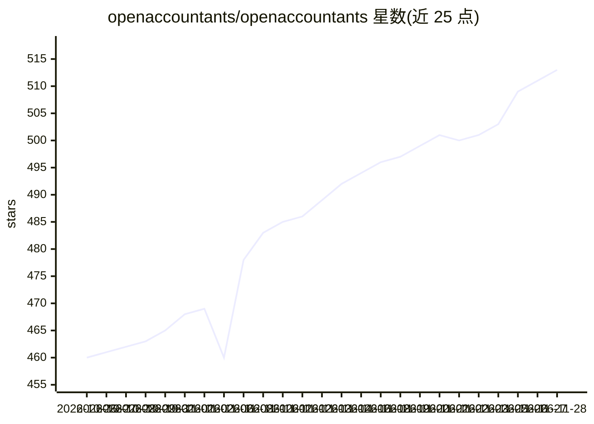

# openaccountants/openaccountants

⭐ 513 · HTML · AGPL-3.0 · 推送 2026-11-27 · [GitHub](https://github.com/openaccountants/openaccountants) · [官网](https://www.openaccountants.com/connect) · 组织维护

**面向 AI 的 190+ 国家/地区税收技能库，数字逐条引证法律来源**

以 SKILL/Markdown 包形式组织的税务知识库，覆盖 283 个国家、州与地区；每条税率、起征点、期限均链接官方来源页，PR 上自动核验数字是否存在于来源页并重算示例。由执业会计师逐条署名审批（当前 34 名会计师批准 100+ 条），审批状态通过其 MCP 插件呈现。使用方式为向 ChatGPT/Claude/Cursor 等添加其 MCP 地址、自托管 Python MCP 服务器或手动上传 packages/ 下的辖区文件。仓库声明为一般参考而非税务建议。

## 筛选速览

| 维度 | 判定 | 备注 |
|---|---|---|
| AI 角色 | `ai-knowledge` | 知识聚合/清单类 |
| 许可风险 | `viral` | AGPL-3.0 |
| 部署形态 | `library` | 以包/库形式分发 |
| 模型依赖 | — | README 未给出锁定关系 |
| 硬件要求 | — | 无带数字的原话,不猜 |
| 安装摩擦 | `low` | 无编译、无系统依赖或容器化 |
| 成熟度 | — | 结构信号不足 |

## 能力要点

- 数字逐条链接官方法律/税务机关页面，PR 自动核验数字与重算示例
- 执业会计师署名审批机制，文本变更即清除审批
- 提供 MCP 端点、Python MCP 服务器与手动下载 packages/ 三种接入方式
- evidence 仓库保存来源页快照以便溯源

## 适用场景

- 让 ChatGPT/Claude 回答各辖区税率、起征点与申报期限并给出法律出处
- 自由职业者判断是否达到 VAT 注册门槛
- 会计师为本国税项技能做署名审批或纠错

## 场景标签

`知识库管理` · 领域:知识与检索

## 证据(README 行号)

> L5: **Tax skills for AI, written from the law and approved by named accountants.** Your AI answers tax questions from me
> L44: Add this address to Claude, ChatGPT, Cursor, Windsurf or any AI that takes a connector:
> L56: - **Python MCP server:** install the tested GitHub revision. The current PyPI release is older and has no bundled s

## 星数曲线

2026-10-26 460 → 2026-11-28 513（+53）

---
*卡片 v1 · prompt 1.4 · 生成 2026-11-27 · 置信度 high · 依据 README sha `0ae264ffa2b4` · [字段定义](../../DATASET.md)*
