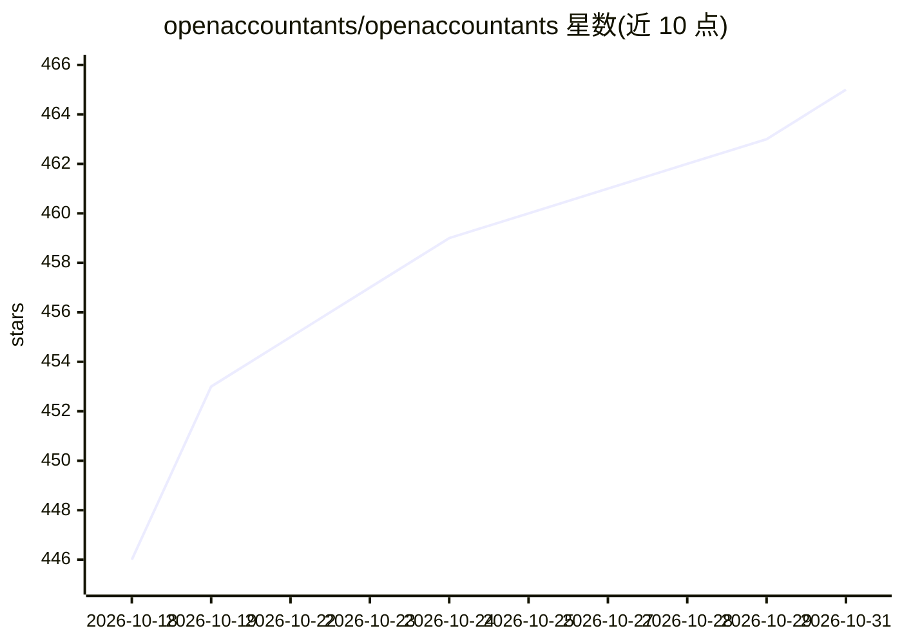

# openaccountants/openaccountants

⭐ 465 · Python · AGPL-3.0 · 推送 2026-10-30 · [GitHub](https://github.com/openaccountants/openaccountants) · [官网](https://www.openaccountants.com/connect) · 组织维护

**190+ 国家税法 AI 技能库：AI 回答税务问题时可引用并标注审查状态**

覆盖 231 个司法辖区的税务知识技能库（1,903 条技能），每条技能处于两种状态之一：会计师审查（署名 reviewed_by）或带来源引用的草稿。AI 通过托管 MCP 连接器（Claude、ChatGPT、Cursor、Windsurf 等 MCP 客户端）、pip 安装的 MCP 服务器或手动上传 packages/ 文件接入，回答时引用所加载技能及其审查状态。每晚由机器检查数学一致性、监控来源页面变化、按月重推导陈旧内容并测试 AI 回答是否符合指南。会计师可在平台撰写或审查技能，署名同步回本仓库。技能内容 source-available，代码为 AGPL-3.0。另提供会计师服务对接。

## 筛选速览

| 维度 | 判定 | 备注 |
|---|---|---|
| AI 角色 | `ai-knowledge` | 知识聚合/清单类 |
| 许可风险 | `viral` | AGPL-3.0 |
| 部署形态 | `library` | 以包/库形式分发 |
| 模型依赖 | — | README 未给出锁定关系 |
| 硬件要求 | — | 无带数字的原话,不猜 |
| 安装摩擦 | `low` | 无编译、无系统依赖或容器化 |
| 成熟度 | — | 结构信号不足 |

## 能力要点

- 1,903 条技能覆盖 231 个司法辖区，38 位署名会计师、33 条经会计师审查
- 技能二态标注：会计师审查 / 带来源引用草稿，机器可 grep
- 每晚数学校验、来源页监控、月度重推导与 AI 回答一致性测试
- 支持托管 MCP 连接器、pip MCP 服务器与手动文件三种接入方式

## 适用场景

- 让我的 AI 助手回答跨国税务问题时引用有来源的税法技能而非训练数据
- 会计师为所在辖区撰写或审查技能并获得署名
- 通过 MCP 客户端按国家查找税法知识包

## 场景标签

`精选清单` · 领域:学习与行业

## 证据(README 行号)

> L3: **Free AI skills (tax rules your AI follows) your AI can cite, with sources and published review status.**
> L19: **1,903 AI skills** across **231 jurisdictions** · **33 accountant-reviewed** · **38 named accountants** · **20,782
> L61: |**Accountant-reviewed**|A named, licensed accountant reviewed the complete skill. Their name is in the frontmatter

## 星数曲线

2026-10-18 446 → 2026-10-31 465（+19）

---
*卡片 v1 · prompt 1.4 · 生成 2026-10-21 · 置信度 high · 依据 README sha `5d4ee3dc793c` · [字段定义](../../DATASET.md)*
