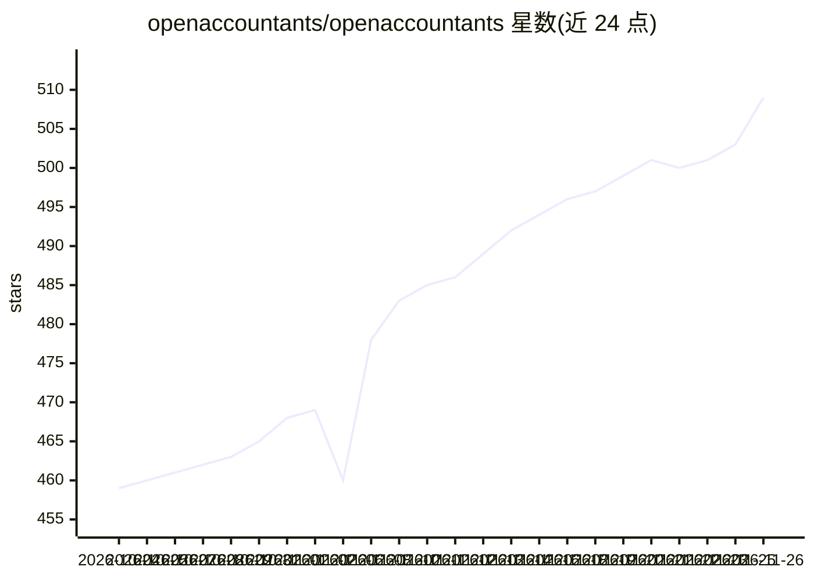

# openaccountants/openaccountants

⭐ 509 · HTML · AGPL-3.0 · 推送 2026-11-25 · [GitHub](https://github.com/openaccountants/openaccountants) · [官网](https://www.openaccountants.com/connect) · 组织维护

**给 AI 客户端接入带出处引用的各国税务技能库**

以 skill 文件形式提供 283 个国家/州/地区的税务知识包，每条税率、起征点、截止日期均链接官方来源；PR 时自动核验数字是否出现在来源页并重算示例。技能由注册会计师署名批准（当前 34 名、28 个辖区，超 100 条获批），批准信息经 MCP 插件展示而非仓库。可通过 MCP 地址接入 Claude/ChatGPT/Cursor 等，或从 packages/ 手动下载上传。仓库声明为通用参考而非税务建议。

## 筛选速览

| 维度 | 判定 | 备注 |
|---|---|---|
| AI 角色 | `ai-knowledge` | 知识聚合/清单类 |
| 许可风险 | `viral` | AGPL-3.0 |
| 部署形态 | `library` | 以包/库形式分发 |
| 模型依赖 | — | README 未给出锁定关系 |
| 硬件要求 | — | 无带数字的原话,不猜 |
| 安装摩擦 | `low` | 无编译、无系统依赖或容器化 |
| 成熟度 | — | 结构信号不足 |

## 能力要点

- 每项数字链接官方法律/税务局页面并经自动核验
- PR 级来源核查与来源页快照存档（evidence 仓库）
- 34 名署名注册会计师批准机制，文本变更即清除批准
- 支持 MCP 接入、Python MCP server 自托管与手动文件上传

## 适用场景

- 让 ChatGPT/Claude 回答税务问题时引用官方法条而非凭记忆
- 自托管 MCP server 供内部使用税务技能
- 会计师认领并批准本国技能署名

## 场景标签

`知识库管理` · 领域:知识与检索

## 证据(README 行号)

> L3: > Every skill here is written from the official law and the tax authority's own pages, with each figure linked to it
> L44: Add this address to Claude, ChatGPT, Cursor, Windsurf or any AI that takes a connector:

## 星数曲线

2026-10-24 459 → 2026-11-26 509（+50）

---
*卡片 v1 · prompt 1.4 · 生成 2026-11-26 · 置信度 mid · 依据 README sha `7cf21fc1f9fd` · [字段定义](../../DATASET.md)*
