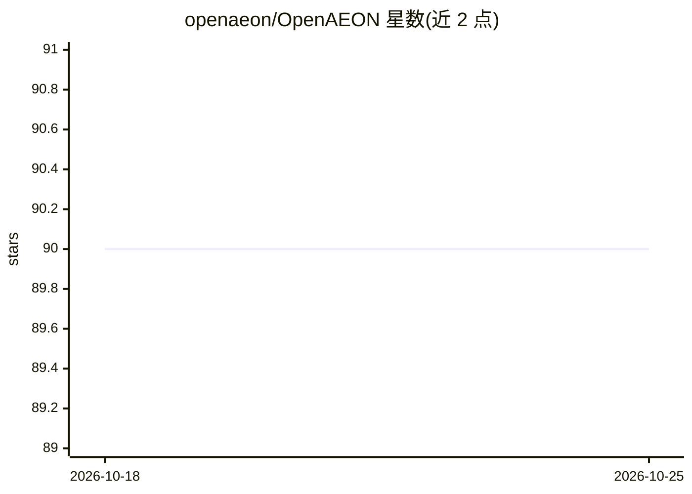

# openaeon/OpenAEON

⭐ 90 · TypeScript · MIT · 推送 2026-07-30 · [GitHub](https://github.com/openaeon/OpenAEON) · [官网](http://docs.openaeon.ai) · 组织维护 · 中文 README

**自研认知循环架构的自主 agent 运行时：推理、记忆蒸馏与可观测控制台**

AEON Protocol 的开源实现，围绕 FCA Core（多层认知架构）构建：任务被分解为 Perceive/Adjudicate/Act/Persist/Trace 五阶段可验证认知循环，支持递归子 agent 委派、零确认 Autopilot、任务状态机（INIT→…→DONE）与心跳看护。记忆分为工作记忆、JSONL 持久流与蒸馏检查点，闲置时触发 Dreaming 模式做公理提取与熵衰减。运行时形态包含 CLI、WebSocket Gateway、浏览器控制 UI（Chat/Sandbox/AEON 视图）与移动/桌面节点，另含 WeChat 自动化技能。

## 筛选速览

| 维度 | 判定 | 备注 |
|---|---|---|
| AI 角色 | `ai-ecosystem` | LLM/agent 周边工具 |
| 许可风险 | `permissive` | MIT |
| 部署形态 | `library` | 以包/库形式分发 |
| 模型依赖 | — | README 未给出锁定关系 |
| 硬件要求 | — | 无带数字的原话,不猜 |
| 安装摩擦 | `low` | 无编译、无系统依赖或容器化 |
| 成熟度 | — | 结构信号不足 |

## 能力要点

- 5 阶段可验证认知循环与结构化状态 API（aeon.status/memory.trace/execution.lookup/thinking.stream）
- 分层记忆：工作记忆 + JSONL 持久流 + 蒸馏检查点（Auto-Seal 保留连续性）
- 分布式 Autopilot：递归子 agent 委派、指数退避重试、任务状态机 v3
- Dreaming 模式：闲置 15 分钟触发公理提取、引力权重与熵衰减

## 适用场景

- 让 agent 在无人值守下长时运行任务并通过 UI 观测认知过程
- 通过 Chat/Sandbox 控制台管理多 agent 会话与策略面板
- 对 agent 记忆与执行轨迹做审计与回放

## 场景标签

`Agent 框架` `Agent 记忆` `多智能体` `LLM 可观测性` · 领域:Agent 开发

## 证据(README 行号)

> L53: ### Current Logic Model (Implemented via FCA)
> L246: OpenAEON currently ships as a coordinated multi-surface system:
> L248: - **CLI (`openaeon`)**: onboarding, config, channels, sessions, diagnostics, and operations.

## 星数曲线

2026-10-18 90 → 2026-10-25 90（+0）

---
*卡片 v1 · prompt 1.4 · 生成 2026-10-23 · 置信度 mid · 依据 README sha `bd30833b6524` · [字段定义](../../DATASET.md)*
