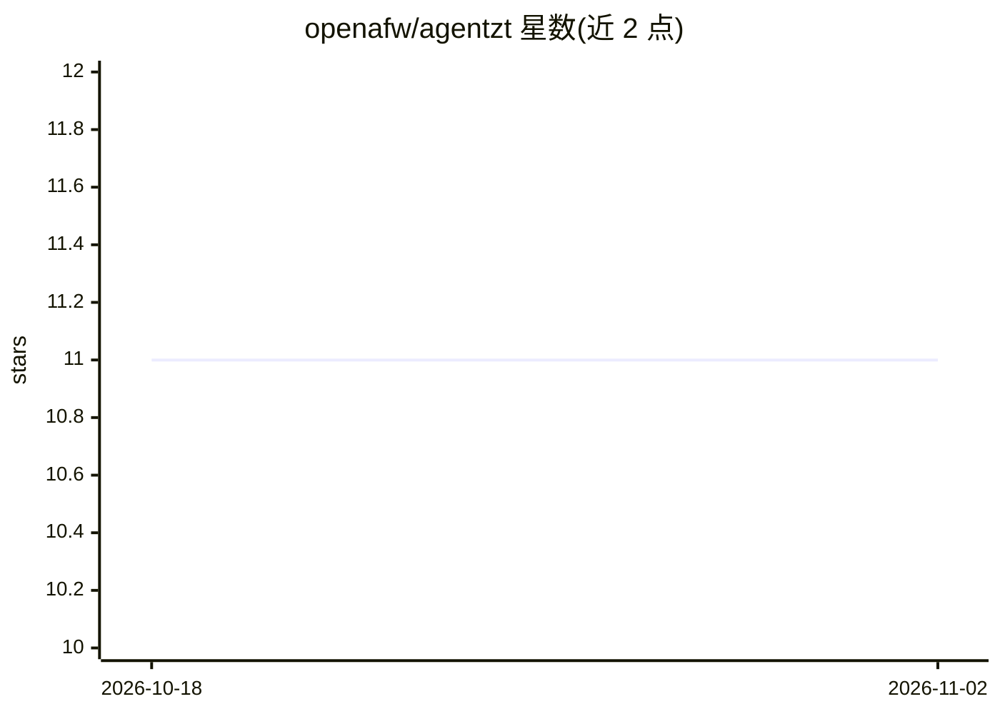

# openafw/agentzt

⭐ 11 · TypeScript · Apache-2.0 · 推送 2026-06-02 · [GitHub](https://github.com/openafw/agentzt) · [官网](https://openguardrails.com) · 组织维护

**AI Agent 零信任参考实现：网关管控 agent 到模型/工具的调用**

实现 Anthropic 零信任 AI Agent 框架（Foundation 层）的开源参考项目，由本地客户端代理（agentzt-client）与网关（agentzt-gateway）组成：agent 仅持有 Ed25519 密钥，企业 API key 只存于网关；网关执行 deny-by-default RBAC、工具参数校验、限流、输入/输出护栏（可接 OpenGuardrails 或本地正则）、ABAC 与 JIT 提权，并写入哈希链防篡改审计日志。默认 mock 上游可离线运行，支持 passthrough 转发 Anthropic 形态的模型 API。自述为 Foundation 层 MVP，尚未面向生产加固。

## 筛选速览

| 维度 | 判定 | 备注 |
|---|---|---|
| AI 角色 | `ai-ecosystem` | LLM/agent 周边工具 |
| 许可风险 | `permissive` | Apache-2.0 |
| 部署形态 | `None` |  |
| 模型依赖 | — | README 未给出锁定关系 |
| 硬件要求 | — | 无带数字的原话,不猜 |
| 安装摩擦 | `low` | 无编译、无系统依赖或容器化 |
| 成熟度 | `idea` | |

## 能力要点

- 客户端+网关架构：企业 API key 仅存于网关，agent 无长期凭证
- deny-by-default RBAC、ABAC（时段/风险）与 JIT 单资源短时提权
- 防篡改审计：append-only 哈希链 + audit --verify
- 输入/输出护栏：可检测间接提示注入并从响应中脱敏密钥
- 可选 mTLS（内部 CA、证书绑定通道），Node ≥22.6 零依赖零构建

## 适用场景

- 为自主 agent 的模型与工具调用加装零信任管控与审计
- 验证提示注入、密钥泄露等防护机制的端到端演示
- 作为零信任 agent 框架的参考实现做二次开发

## 场景标签

 · 领域:AI 安全/基础设施

## 证据(README 行号)

> L17: - **`agentzt-gateway`** — the policy decision + enforcement point. It authenticates the
> L18:  agent, issues short-lived scoped tokens, applies deny-by-default RBAC (which models /
> L19:  which tools), validates tool parameters, rate-limits, and audits every action before

## 星数曲线

2026-10-18 11 → 2026-11-02 11（+0）

---
*卡片 v1 · prompt 1.4 · 生成 2026-11-01 · 置信度 high · 依据 README sha `f09b81ed37ee` · [字段定义](../../DATASET.md)*
